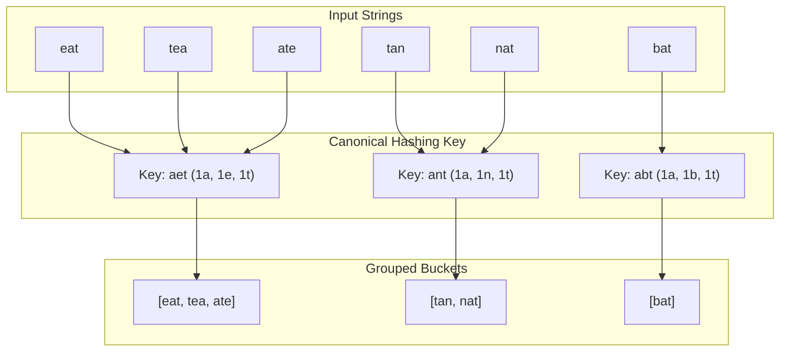

# 0049. Group Anagrams

- **Difficulty:** Medium
- **Topic:** Arrays & Hashing
- **Pattern:** Hash Map Grouping (Categorization by Canonical Signature)
- **LeetCode Link:** [Group Anagrams](https://leetcode.com/problems/group-anagrams/)

---

## Problem Statement

Given an array of strings `strs`, group the **anagrams** together. You can return the answer in **any order**.

An **Anagram** is a word or phrase formed by rearranging the letters of a different word or phrase, typically using all the original letters exactly once.

### Examples

**Example 1:**
```text
Input: strs = ["eat","tea","tan","ate","nat","bat"]
Output: [["bat"],["nat","tan"],["ate","eat","tea"]]
```

**Example 2:**
```text
Input: strs = [""]
Output: [[""]]
```

**Example 3:**
```text
Input: strs = ["a"]
Output: [["a"]]
```

---

## 💡 Intuition & Canonical Signatures

Two words are anagrams if and only if they share the **exact same character counts**. 
To group them together in a Hash Map `Map<Signature, List<String>>`, we need a **canonical key** that is identical for all anagrams of a word.

### Visual Workflow



---

## 🚀 Approach 1: Sorted String as Key

Sort each word alphabetically. All anagrams will produce the exact same sorted string:
- `"eat" -> "aet"`
- `"tea" -> "aet"`
- `"ate" -> "aet"`

Use this sorted string as the hash map key.

### Python 3
```python
from collections import defaultdict

class Solution:
    def groupAnagrams(self, strs: list[str]) -> list[list[str]]:
        groups = defaultdict(list)
        for s in strs:
            groups["".join(sorted(s))].append(s)
        return list(groups.values())
```

### Java
```java
import java.util.*;

class Solution {
    public List<List<String>> groupAnagrams(String[] strs) {
        Map<String, List<String>> map = new HashMap<>();
        for (String s : strs) {
            char[] chars = s.toCharArray();
            Arrays.sort(chars);
            String sortedKey = new String(chars);
            map.computeIfAbsent(sortedKey, k -> new ArrayList<>()).add(s);
        }
        return new ArrayList<>(map.values());
    }
}
```

### Complexity
- **Time Complexity:** $O(N \cdot K \log K)$, where $N$ is the number of strings and $K$ is the maximum length of a string.
- **Space Complexity:** $O(N \cdot K)$ to store strings inside hash map buckets.

---

## 🌟 Approach 2: 26-Element Frequency Signature (Optimal)

Instead of sorting in $O(K \log K)$, we count character frequencies in $O(K)$ time.
Since all characters are lowercase English letters (`'a'` to `'z'`), we create a fixed 26-integer count array. In Python, a tuple of length 26 is hashable. In Java, we serialize the 26 counts with delimiters (e.g., `#1#0#0...`).

### Python 3
```python
from collections import defaultdict

class Solution:
    def groupAnagrams(self, strs: list[str]) -> list[list[str]]:
        groups = defaultdict(list)
        offset = ord('a')
        
        for s in strs:
            count = [0] * 26
            for char in s:
                count[ord(char) - offset] += 1
            groups[tuple(count)].append(s)
            
        return list(groups.values())
```

### Java
```java
import java.util.*;

class Solution {
    public List<List<String>> groupAnagrams(String[] strs) {
        Map<String, List<String>> map = new HashMap<>();
        for (String s : strs) {
            int[] counts = new int[26];
            for (char c : s.toCharArray()) {
                counts[c - 'a']++;
            }
            StringBuilder sb = new StringBuilder();
            for (int count : counts) {
                sb.append('#').append(count);
            }
            String signature = sb.toString();
            map.computeIfAbsent(signature, k -> new ArrayList<>()).add(s);
        }
        return new ArrayList<>(map.values());
    }
}
```

### Complexity
- **Time Complexity:** $O(N \cdot K)$ — strictly linear in the total number of characters.
- **Space Complexity:** $O(N \cdot K)$ to store grouped strings in the hash map.
