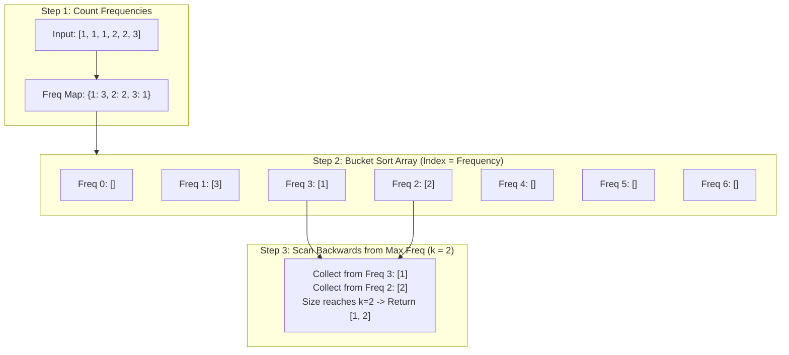

# 0347. Top K Frequent Elements

- **Difficulty:** Medium
- **Topic:** Arrays & Hashing
- **Pattern:** Frequency Bucket Sort vs. Min-Heap
- **LeetCode Link:** [Top K Frequent Elements](https://leetcode.com/problems/top-k-frequent-elements/)

---

## Problem Statement

Given an integer array `nums` and an integer `k`, return the `k` **most frequent elements**. You may return the answer in **any order**.

### Examples

**Example 1:**
```text
Input: nums = [1,1,1,2,2,3], k = 2
Output: [1,2]
```

**Example 2:**
```text
Input: nums = [1], k = 1
Output: [1]
```

---

## 💡 Intuition & Visual Breakdown

Instead of sorting frequencies in $O(N \log N)$ or maintaining a heap in $O(N \log K)$, notice a key constraint:
* **The maximum possible frequency of any element in an array of size $N$ is $N$.**

This allows us to use **Bucket Sort**, where the **array index represents frequency**, running in pure linear $O(N)$ time!

### Bucket Sort Architecture



---

## 🚀 Approach 1: Min-Heap of Size $K$

1. Count frequencies with a Hash Map.
2. Push `(frequency, element)` pairs into a Min-Heap.
3. If heap size exceeds $k$, evict the minimum element (`heappop()`).
4. The remaining $k$ elements in the heap are the $k$ most frequent.

### Python 3
```python
from collections import Counter
import heapq

class Solution:
    def topKFrequent(self, nums: list[int], k: int) -> list[int]:
        count = Counter(nums)
        min_heap = []
        for num, freq in count.items():
            heapq.heappush(min_heap, (freq, num))
            if len(min_heap) > k:
                heapq.heappop(min_heap)
        return [num for freq, num in min_heap]
```

### Java
```java
import java.util.*;

class Solution {
    public int[] topKFrequent(int[] nums, int k) {
        Map<Integer, Integer> map = new HashMap<>();
        for (int num : nums) map.put(num, map.getOrDefault(num, 0) + 1);

        PriorityQueue<Integer> pq = new PriorityQueue<>(Comparator.comparingInt(map::get));
        for (int num : map.keySet()) {
            pq.offer(num);
            if (pq.size() > k) pq.poll();
        }

        int[] result = new int[k];
        for (int i = 0; i < k; i++) result[i] = pq.poll();
        return result;
    }
}
```

### Complexity
- **Time Complexity:** $O(N \log K)$ — pushing $N$ unique elements into a heap of bounded size $k$.
- **Space Complexity:** $O(N + K)$ for the frequency map and heap.

---

## 🌟 Approach 2: Bucket Sort (Optimal Linear Time)

1. Build a frequency count map.
2. Initialize an array of buckets of size $N + 1$, where `buckets[f]` stores numbers with frequency `f`.
3. Scan from index $N$ down to $1$ collecting elements until $k$ elements are gathered.

### Python 3
```python
from collections import Counter

class Solution:
    def topKFrequent(self, nums: list[int], k: int) -> list[int]:
        count = Counter(nums)
        n = len(nums)
        buckets = [[] for _ in range(n + 1)]

        for num, freq in count.items():
            buckets[freq].append(num)

        result = []
        for freq in range(n, 0, -1):
            for num in buckets[freq]:
                result.append(num)
                if len(result) == k:
                    return result
        return result
```

### Java
```java
import java.util.*;

class Solution {
    @SuppressWarnings("unchecked")
    public int[] topKFrequent(int[] nums, int k) {
        Map<Integer, Integer> map = new HashMap<>();
        for (int num : nums) map.put(num, map.getOrDefault(num, 0) + 1);

        int n = nums.length;
        List<Integer>[] buckets = new List[n + 1];

        for (Map.Entry<Integer, Integer> entry : map.entrySet()) {
            int freq = entry.getValue();
            if (buckets[freq] == null) buckets[freq] = new ArrayList<>();
            buckets[freq].add(entry.getKey());
        }

        int[] result = new int[k];
        int index = 0;
        for (int freq = n; freq >= 1 && index < k; freq--) {
            if (buckets[freq] != null) {
                for (int num : buckets[freq]) {
                    result[index++] = num;
                    if (index == k) return result;
                }
            }
        }
        return result;
    }
}
```

### Complexity
- **Time Complexity:** $O(N)$ — counting takes $O(N)$, bucket placement takes $O(N)$, reverse scan takes $O(N)$.
- **Space Complexity:** $O(N)$ — buckets array bounded by length of `nums`.
