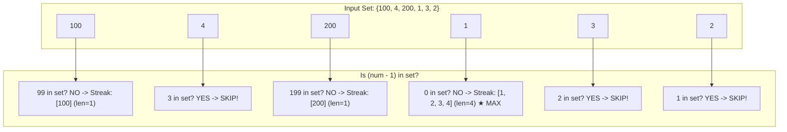

# 0128. Longest Consecutive Sequence

- **Difficulty:** Medium
- **Topic:** Arrays & Hashing
- **Pattern:** Hash Set Intelligent Sequence Start Check
- **LeetCode Link:** [Longest Consecutive Sequence](https://leetcode.com/problems/longest-consecutive-sequence/)

---

## Problem Statement

Given an unsorted array of integers `nums`, return the length of the longest consecutive elements sequence.

You must write an algorithm that runs in **$O(N)$ time**.

### Examples

**Example 1:**
```text
Input: nums = [100,4,200,1,3,2]
Output: 4
Explanation: The longest consecutive elements sequence is [1, 2, 3, 4]. Therefore its length is 4.
```

**Example 2:**
```text
Input: nums = [0,3,7,2,5,8,4,6,0,1]
Output: 9
Explanation: The sequence is [0, 1, 2, 3, 4, 5, 6, 7, 8]. Length is 9.
```

---

## 💡 Intuition & Why This is Linear $O(N)$

A naive check from every number could expand redundant sequences (e.g. scanning `2 -> 3 -> 4`, then `3 -> 4`, etc.), leading to $O(N^2)$ worst-case time.

### The Golden Optimization: Only Start at the Sequence Head
A number `x` is the **beginning** of a consecutive sequence **if and only if `x - 1` is NOT present in the set**.
* If `x - 1` exists, skip `x`! It will be naturally included when the streak started from its predecessor.
* If `x - 1` does NOT exist, `x` is a true sequence head. Expand forward: `x + 1`, `x + 2`, etc.

### Visual Diagram



Because each number is traversed as part of an inner loop at most once, the overall time is **strictly $O(N)$**!

---

## 🚀 Implementations

### Python 3
```python
class Solution:
    def longestConsecutive(self, nums: list[int]) -> int:
        num_set = set(nums)
        longest = 0

        for num in num_set:
            # Only start if 'num' is the beginning of a sequence
            if (num - 1) not in num_set:
                current_num = num
                current_streak = 1

                while (current_num + 1) in num_set:
                    current_num += 1
                    current_streak += 1

                longest = max(longest, current_streak)

        return longest
```

### Java
```java
import java.util.HashSet;
import java.util.Set;

class Solution {
    public int longestConsecutive(int[] nums) {
        if (nums == null || nums.length == 0) return 0;

        Set<Integer> numSet = new HashSet<>();
        for (int num : nums) numSet.add(num);

        int longest = 0;
        for (int num : numSet) {
            // Sequence start condition
            if (!numSet.contains(num - 1)) {
                int curr = num;
                int streak = 1;

                while (numSet.contains(curr + 1)) {
                    curr++;
                    streak++;
                }

                longest = Math.max(longest, streak);
            }
        }
        return longest;
    }
}
```

---

## 📊 Complexity Analysis

- **Time Complexity:** $O(N)$ — Creating the set takes $O(N)$. Looking up `num - 1` takes $O(1)$. Each element is touched by the inner `while` loop at most once across the entire execution.
- **Space Complexity:** $O(N)$ — To store the unique elements in the hash set.
