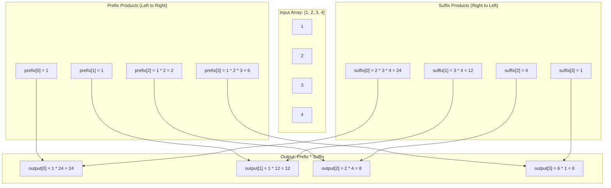

# 0238. Product of Array Except Self

- **Difficulty:** Medium
- **Topic:** Arrays & Hashing
- **Pattern:** Prefix & Suffix Products (Running Product Accumulation)
- **LeetCode Link:** [Product of Array Except Self](https://leetcode.com/problems/product-of-array-except-self/)

---

## Problem Statement

Given an integer array `nums`, return an array `answer` such that `answer[i]` is equal to the product of all the elements of `nums` except `nums[i]`.

The product of any prefix or suffix of `nums` is **guaranteed** to fit in a **32-bit** integer.

You must write an algorithm that runs in **$O(N)$ time** and **without using the division operation**.

### Follow-up
Can you solve the problem in **$O(1)$ extra space complexity**? (The output array does not count as extra space for space complexity analysis.)

---

## 💡 Intuition & Visual Decomposition

For any index $i$, the product of all elements except `nums[i]` is:
$$\text{answer}[i] = (\text{product of all elements to the left of } i) \times (\text{product of all elements to the right of } i)$$
$$\text{answer}[i] = \text{prefix}[i] \times \text{suffix}[i]$$

### Visual Prefix & Suffix Array Flow



---

## 🚀 Approach 1: Two Separate Prefix & Suffix Arrays

Allocate two arrays:
1. `prefix[i]`: Cumulative product of elements strictly before index $i$.
2. `suffix[i]`: Cumulative product of elements strictly after index $i$.
3. Compute `result[i] = prefix[i] * suffix[i]`.

- **Time Complexity:** $O(N)$ — 3 linear iterations.
- **Space Complexity:** $O(N)$ — auxiliary arrays for prefix and suffix.

---

## 🌟 Approach 2: $O(1)$ Extra Space (Optimal)

We eliminate both auxiliary arrays:
1. Store prefix products directly in the returned `output` array.
2. Traverse backwards with a single variable `suffix` (initialized to 1), multiplying `output[i] *= suffix`, then updating `suffix *= nums[i]`.

### Python 3
```python
class Solution:
    def productExceptSelf(self, nums: list[int]) -> list[int]:
        n = len(nums)
        output = [1] * n
        
        # Pass 1: Prefix products stored in output
        prefix = 1
        for i in range(n):
            output[i] = prefix
            prefix *= nums[i]
            
        # Pass 2: Multiply by suffix product using rolling variable
        suffix = 1
        for i in range(n - 1, -1, -1):
            output[i] *= suffix
            suffix *= nums[i]
            
        return output
```

### Java
```java
class Solution {
    public int[] productExceptSelf(int[] nums) {
        int n = nums.length;
        int[] output = new int[n];
        
        // Pass 1: Prefix products
        output[0] = 1;
        for (int i = 1; i < n; i++) {
            output[i] = output[i - 1] * nums[i - 1];
        }
        
        // Pass 2: Suffix products
        int suffix = 1;
        for (int i = n - 1; i >= 0; i--) {
            output[i] *= suffix;
            suffix *= nums[i];
        }
        
        return output;
    }
}
```

### Complexity Analysis
- **Time Complexity:** $O(N)$ — Two sequential passes over the array of size $N$.
- **Space Complexity:** $O(1)$ auxiliary memory — only scalar variables used; the output array is excluded per problem specifications.
