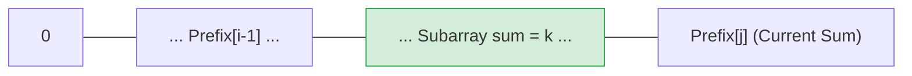

# 0560. Subarray Sum Equals K

- **Difficulty:** Medium
- **Topic:** Arrays & Hashing
- **Pattern:** Prefix Sum + Hash Map (Target Complement Counting)
- **LeetCode Link:** [Subarray Sum Equals K](https://leetcode.com/problems/subarray-sum-equals-k/)

---

## Problem Statement

Given an array of integers `nums` and an integer `k`, return the total number of **subarrays** whose sum equals to `k`.

A **subarray** is a contiguous non-empty sequence of elements within an array.

---

## 💡 Why Sliding Window Fails & Prefix Sum Succeeds

> [!WARNING]
> Because `nums` can contain **negative numbers**, cumulative sums do NOT grow monotonically! Expanding or shrinking a sliding window cannot guarantee discovering all valid subarrays.

### The Prefix Sum Invariant
Let $\text{prefix}[x]$ denote the sum from index $0$ to $x$. The sum of a contiguous subarray from index $i$ to $j$ is:

$$\text{sum}(i \dots j) = \text{prefix}[j] - \text{prefix}[i - 1]$$

For this subarray sum to equal $k$:
$$\text{prefix}[j] - \text{prefix}[i - 1] = k \implies \text{prefix}[i - 1] = \text{prefix}[j] - k$$

As we maintain `current_sum` ($\text{prefix}[j]$):
* We query a hash map: **How many times has $(\text{current\_sum} - k)$ appeared before?**
* We add that frequency directly to our count!

### Visual Relationship



### Essential Base Case: `prefix_counts[0] = 1`
If a subarray starting at index `0` sums to `k`, then `current_sum - k = 0`. To account for these subarrays, the hash map must be pre-seeded with `{0: 1}`.

---

## 🚀 Implementations

### Python 3
```python
from collections import defaultdict

class Solution:
    def subarraySum(self, nums: list[int], k: int) -> int:
        count = 0
        current_sum = 0
        prefix_counts = defaultdict(int)
        prefix_counts[0] = 1  # Base case for subarrays starting at index 0

        for num in nums:
            current_sum += num
            complement = current_sum - k
            
            if complement in prefix_counts:
                count += prefix_counts[complement]
                
            prefix_counts[current_sum] += 1

        return count
```

### Java
```java
import java.util.HashMap;
import java.util.Map;

class Solution {
    public int subarraySum(int[] nums, int k) {
        int count = 0;
        int currentSum = 0;
        Map<Integer, Integer> prefixCounts = new HashMap<>();
        prefixCounts.put(0, 1);

        for (int num : nums) {
            currentSum += num;
            int complement = currentSum - k;

            if (prefixCounts.containsKey(complement)) {
                count += prefixCounts.get(complement);
            }

            prefixCounts.put(currentSum, prefixCounts.getOrDefault(currentSum, 0) + 1);
        }

        return count;
    }
}
```

---

## 📊 Complexity Analysis

- **Time Complexity:** $O(N)$ — Single pass over `nums` with $O(1)$ amortized hash map lookups.
- **Space Complexity:** $O(N)$ — Hash map stores up to $N + 1$ distinct prefix sums in the worst case.
