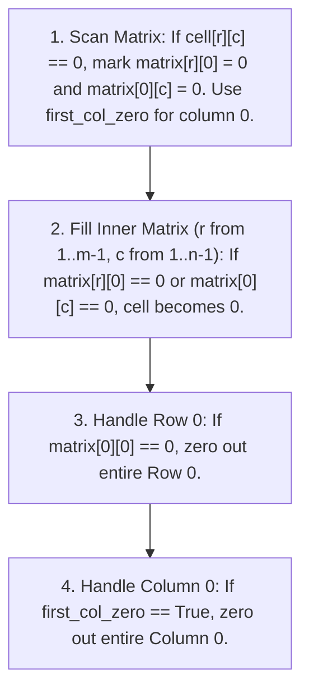

# 0073. Set Matrix Zeroes

- **Difficulty:** Medium
- **Topic:** Arrays & Hashing
- **Pattern:** In-Place Matrix State Marking (Using 1st Row & 1st Column as Markers)
- **LeetCode Link:** [Set Matrix Zeroes](https://leetcode.com/problems/set-matrix-zeroes/)

---

## Problem Statement

Given an $m \times n$ integer matrix `matrix`, if an element is `0`, set its entire row and column to `0`'s.

You must do it **in place**.

### Follow-up
* An $O(m \cdot n)$ space solution is trivial (making a duplicate matrix).
* An $O(m + n)$ space solution uses row/col boolean arrays.
* **Can you devise a constant $O(1)$ space solution?**

---

## 💡 Intuition & O(1) In-Place Marker Architecture

Rather than allocating external arrays `row[m]` and `col[n]`, we can **repurpose the first row and first column of the matrix itself as our marker arrays**!

```text
matrix[r][0] = 0  --> Row r must be zeroed out
matrix[0][c] = 0  --> Column c must be zeroed out
```

### The Overlap Conflict at Cell `[0][0]`
Notice cell `matrix[0][0]` is shared by both row `0` and column `0`:
* We let `matrix[0][0]` designate whether **Row 0** should be zeroed.
* We introduce a single boolean variable `first_col_zero` to track whether **Column 0** should be zeroed.

### Step-by-Step State Flow



---

## 🚀 Implementations

### Python 3
```python
class Solution:
    def setZeroes(self, matrix: list[list[int]]) -> None:
        m, n = len(matrix), len(matrix[0])
        first_col_zero = False

        # Step 1: Record zero markers in first row & column
        for r in range(m):
            if matrix[r][0] == 0:
                first_col_zero = True
            for c in range(1, n):
                if matrix[r][c] == 0:
                    matrix[r][0] = 0
                    matrix[0][c] = 0

        # Step 2: Zero out inner cells based on markers
        for r in range(1, m):
            for c in range(1, n):
                if matrix[r][0] == 0 or matrix[0][c] == 0:
                    matrix[r][c] = 0

        # Step 3: Zero out first row if marked
        if matrix[0][0] == 0:
            for c in range(n):
                matrix[0][c] = 0

        # Step 4: Zero out first column if marked
        if first_col_zero:
            for r in range(m):
                matrix[r][0] = 0
```

### Java
```java
class Solution {
    public void setZeroes(int[][] matrix) {
        int m = matrix.length;
        int n = matrix[0].length;
        boolean firstColZero = false;

        for (int r = 0; r < m; r++) {
            if (matrix[r][0] == 0) firstColZero = true;
            for (int c = 1; c < n; c++) {
                if (matrix[r][c] == 0) {
                    matrix[r][0] = 0;
                    matrix[0][c] = 0;
                }
            }
        }

        for (int r = 1; r < m; r++) {
            for (int c = 1; c < n; c++) {
                if (matrix[r][0] == 0 || matrix[0][c] == 0) {
                    matrix[r][c] = 0;
                }
            }
        }

        if (matrix[0][0] == 0) {
            for (int c = 0; c < n; c++) matrix[0][c] = 0;
        }

        if (firstColZero) {
            for (int r = 0; r < m; r++) matrix[r][0] = 0;
        }
    }
}
```

---

## 📊 Complexity Analysis

- **Time Complexity:** $O(M \times N)$ — Two full matrix passes.
- **Space Complexity:** $O(1)$ auxiliary memory — No extra data structures; state is embedded in the existing matrix.
