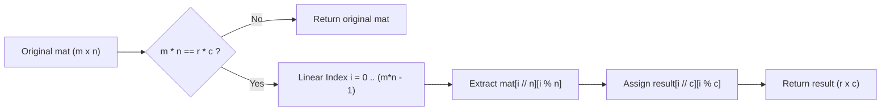

# 0566. Reshape the Matrix

## Problem Description
In MATLAB, there is a handy function called `reshape` which can reshape an `m x n` matrix into a new one with a different size `r x c` keeping its original data.

You are given an `m x n` matrix `mat` and two integers `r` and `c` representing the number of rows and number of columns of the wanted reshaped matrix.

The reshaped matrix should be filled with all the elements of the original matrix in the same row-traversing order as they were.

If the `reshape` operation with given parameters is possible and legal, output the new reshaped matrix; Otherwise, output the original matrix.

[LeetCode Problem Link](https://leetcode.com/problems/reshape-the-matrix/)

---

## 1. Mathematical Principle: 1D Linear Mapping

A matrix of dimensions $m \times n$ contains $m \cdot n$ elements. We can establish a bijective mapping between a single index $i \in [0, m \cdot n - 1]$ and any 2D coordinate grid:

```
For index i in [0, m * n - 1]:
  Original Matrix:
    row = i // n
    col = i % n

  Reshaped Matrix (r x c):
    row_new = i // c
    col_new = i % c
```

### Legality Check
A reshape is valid if and only if the total cell count is conserved:
$$m \cdot n = r \cdot c$$
If $m \cdot n \neq r \cdot c$, the operation is illegal and we return `mat` as-is.

---

## 2. Architecture & Data Flow



---

## 3. Complexity Analysis

| Metric | Complexity | Notes |
| :--- | :--- | :--- |
| **Time Complexity** | $O(m \cdot n)$ | Each of the $m \cdot n$ cells is read and written exactly once. |
| **Space Complexity** | $O(1)$ | Auxiliary space is $O(1)$ beyond the required output matrix of size $r \times c$. |
