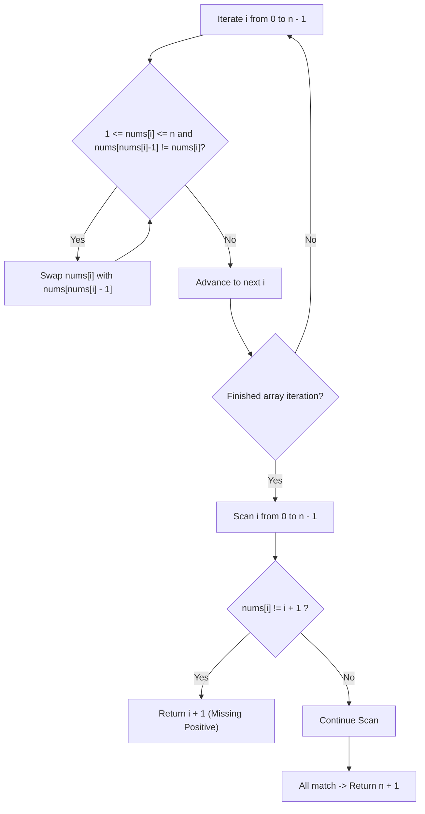

# 0041. First Missing Positive

## Problem Description
Given an unsorted integer array `nums`, return the smallest missing positive integer.

You must implement an algorithm that runs in $O(n)$ time and uses $O(1)$ auxiliary space.

[LeetCode Problem Link](https://leetcode.com/problems/first-missing-positive/)

---

## 1. Key Mathematical Principle: Pigeonhole Range Bound

For an array of length $n$:
- If the array contains all numbers from $1$ to $n$, the first missing positive integer is $n + 1$.
- If any number in the range $[1, n]$ is absent, the missing positive integer **must be $\le n$**.

Therefore, the target answer **strictly lies in the interval $[1, n + 1]$**. Any values $\le 0$ or $> n$ can be ignored because they cannot be the smallest missing positive within the valid range $[1, n]$.

---

## 2. In-Place Cyclic Sort Algorithm

We utilize the array itself as a hash table where index $i$ should house value $i + 1$:
$$\text{nums}[i] = i + 1 \iff \text{value } x \text{ belongs at index } x - 1$$

### Cyclic Swap Invariant:
For index $i$:
While $1 \le \text{nums}[i] \le n$ and $\text{nums}[\text{nums}[i] - 1] \neq \text{nums}[i]$:
$$\text{swap}(\text{nums}[i], \text{nums}[\text{nums}[i] - 1])$$

---

## 3. Complexity Analysis

| Metric | Complexity | Proof / Rationale |
| :--- | :--- | :--- |
| **Time Complexity** | $O(N)$ | Each swap operation permanently places at least one number into its correct position ($x$ at index $x - 1$). Since each element can be placed correctly at most once, the total number of swaps across all iterations is at most $N$. Thus, the `while` loop runs in amortized $O(1)$ per element, leading to $O(N)$ total time. |
| **Space Complexity** | $O(1)$ | Swaps are executed directly within the input array without allocating auxiliary lists, sets, or hash tables. |
