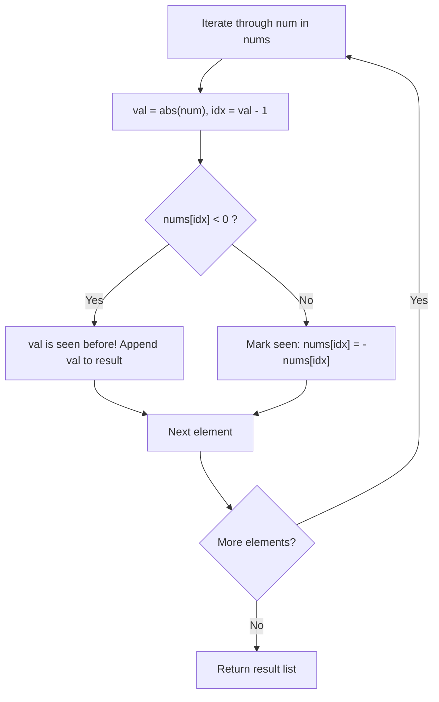

# 0442. Find All Duplicates in an Array

## Problem Description
Given an integer array `nums` of length $n$ where all the integers of `nums` are in the range $[1, n]$ and each integer appears **at most twice**, return an array of all the integers that appear **twice**.

You must write an algorithm that runs in $O(n)$ time and uses only constant auxiliary space (excluding the output list).

[LeetCode Problem Link](https://leetcode.com/problems/find-all-duplicates-in-an-array/)

---

## 1. Algorithmic Principle: Index-as-Hash-Table

Because every number is strictly bounded $1 \le \text{nums}[i] \le n$, the array indices $0$ to $n - 1$ form a perfect direct-address table.

Instead of an external hash set:
1. When encountering value $x = |\text{nums}[i]|$, target index is $\text{idx} = x - 1$.
2. Check $\text{nums}[\text{idx}]$:
   - If $\text{nums}[\text{idx}] < 0$: The index $\text{idx}$ was already visited. Thus, $x$ has appeared for the second time $\implies$ **Add $x$ to output**.
   - If $\text{nums}[\text{idx}] > 0$: First appearance $\implies$ **Negate $\text{nums}[\text{idx}]$**.

---

## 2. In-Place State Flow

---

## 3. Complexity Analysis

| Metric | Complexity | Notes |
| :--- | :--- | :--- |
| **Time Complexity** | $O(N)$ | Single pass examining each element and updating sign in $O(1)$ time. |
| **Space Complexity** | $O(1)$ | No extra memory allocated beyond the required result list. |
