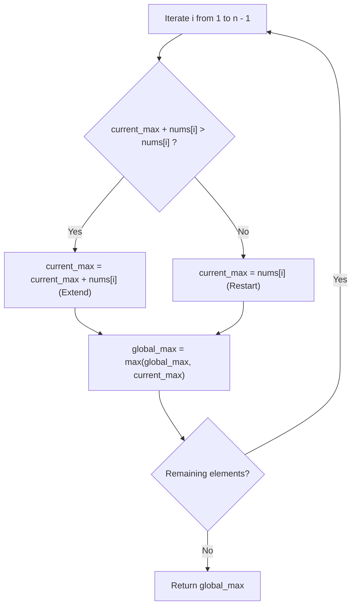

# 0053. Maximum Subarray

## Problem Description
Given an integer array `nums`, find the subarray with the largest sum, and return its sum.

**Follow up:** If you have figured out the $O(n)$ solution, try coding another solution using the divide and conquer approach, which is more subtle.

[LeetCode Problem Link](https://leetcode.com/problems/maximum-subarray/)

---

## 1. Algorithmic Principle: Kadane's Algorithm

Let $\text{dp}[i]$ denote the maximum sum of a contiguous subarray ending at index $i$.

At each position $i$, we face a binary choice:
1. Extend the best subarray ending at $i - 1$: $\text{dp}[i - 1] + \text{nums}[i]$
2. Discard previous accumulation and start a new subarray at $i$: $\text{nums}[i]$

$$\text{dp}[i] = \max(\text{nums}[i], \text{dp}[i - 1] + \text{nums}[i])$$

Because $\text{dp}[i]$ depends only on $\text{dp}[i - 1]$, we compress the DP table into a single scalar variable `current_max`, reducing space complexity from $O(N)$ to $O(1)$.

```
Example: nums = [-2, 1, -3, 4, -1, 2, 1, -5, 4]

Step-by-step state transition:
i = 0: num = -2 | current_max = -2 | global_max = -2
i = 1: num =  1 | current_max =  1 | global_max =  1
i = 2: num = -3 | current_max = -2 | global_max =  1
i = 3: num =  4 | current_max =  4 | global_max =  4
i = 4: num = -1 | current_max =  3 | global_max =  4
i = 5: num =  2 | current_max =  5 | global_max =  5
i = 6: num =  1 | current_max =  6 | global_max =  6  <-- MAX SUBARRAY [4, -1, 2, 1]
i = 7: num = -5 | current_max =  1 | global_max =  6
i = 8: num =  4 | current_max =  5 | global_max =  6

Result: 6
```

---

## 2. Decision Tree & Data Flow



---

## 3. Complexity Analysis

| Metric | Complexity | Notes |
| :--- | :--- | :--- |
| **Time Complexity** | $O(N)$ | Single linear pass through the input array. |
| **Space Complexity** | $O(1)$ | Uses two running variables: `current_max` and `global_max`. |
