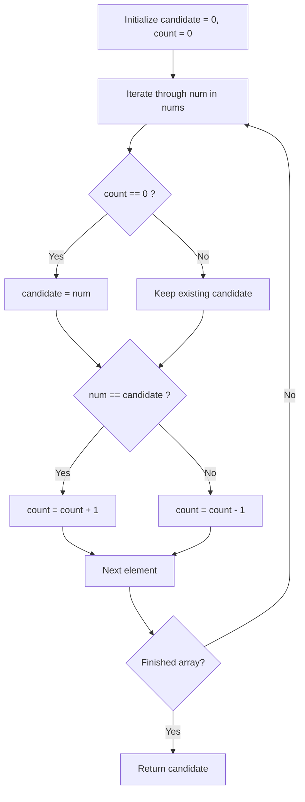

# 0169. Majority Element

## Problem Description
Given an array `nums` of size $n$, return the *majority element*.

The majority element is the element that appears more than $\lfloor n / 2 \rfloor$ times. You may assume that the majority element always exists in the array.

**Follow-up:** Could you solve the problem in linear time and in $O(1)$ space?

[LeetCode Problem Link](https://leetcode.com/problems/majority-element/)

---

## 1. Algorithmic Principle: Boyer-Moore Voting Algorithm

If an element $M$ appears with count $> n/2$, then its total frequency exceeds the sum of frequencies of all other elements combined:
$$\text{count}(M) > \sum_{x \neq M} \text{count}(x)$$

If we pair up different elements and eliminate both, the majority element is guaranteed to remain unpaired:

---

## 2. Complexity Analysis

| Metric | Complexity | Notes |
| :--- | :--- | :--- |
| **Time Complexity** | $O(N)$ | Single linear scan through `nums`. |
| **Space Complexity** | $O(1)$ | Uses only two primitive scalar variables (`candidate`, `count`). |
