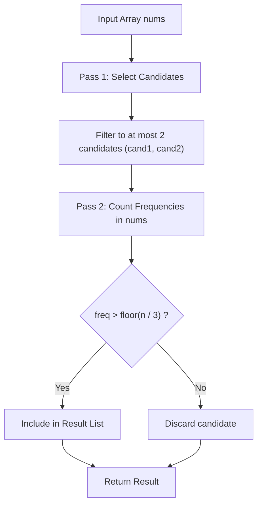

# 0229. Majority Element II

## Problem Description
Given an integer array of size $n$, find all elements that appear more than $\lfloor n / 3 \rfloor$ times.

**Follow-up:** Could you solve the problem in linear time and in $O(1)$ space?

[LeetCode Problem Link](https://leetcode.com/problems/majority-element-ii/)

---

## 1. Algorithmic Principle: Extended Boyer-Moore Voting

By the **Pigeonhole Principle**:
If $k$ elements each appear strictly more than $\lfloor n / 3 \rfloor$ times, then:
$$k \cdot \left(\lfloor n / 3 \rfloor + 1\right) \le n \implies k \le 2$$

There can be **at most 2 majority elements** exceeding the $n / 3$ frequency threshold.

### Triplet Cancellation:
Instead of pairing up 2 distinct elements (as in standard Boyer-Moore), we form groups of **3 mutually distinct elements** and discard them. Any element with frequency $> n/3$ cannot be completely eliminated by this triplet cancellation.

```
State Tracking:
- cand1, count1
- cand2, count2

Transitions for current number x:
1. If x == cand1: count1++
2. Else if x == cand2: count2++
3. Else if count1 == 0: cand1 = x, count1 = 1
4. Else if count2 == 0: cand2 = x, count2 = 1
5. Else: count1--, count2-- (triplet cancellation)
```

---

## 2. Dual-Pass Architecture



---

## 3. Complexity Analysis

| Metric | Complexity | Notes |
| :--- | :--- | :--- |
| **Time Complexity** | $O(N)$ | Two linear scans: Pass 1 selects candidates; Pass 2 counts exact frequencies. |
| **Space Complexity** | $O(1)$ | Auxiliary memory is constant (4 primitive variables for candidates and counters). |
