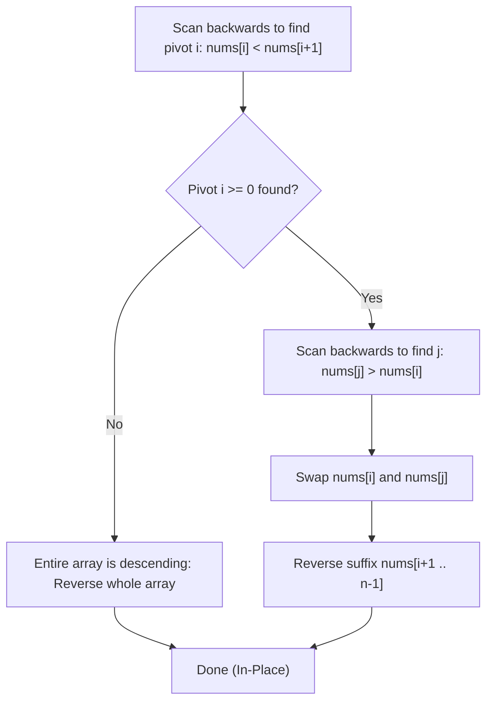

# 0031. Next Permutation

## Problem Description
A **permutation** of an array of integers is an arrangement of its members into a sequence or linear order.

For example, for `arr = [1, 2, 3]`, the following are all the permutations of `arr`: `[1, 2, 3]`, `[1, 3, 2]`, `[2, 1, 3]`, `[2, 3, 1]`, `[3, 1, 2]`, `[3, 2, 1]`.

The **next permutation** of an array of integers is the next lexicographically greater permutation of its integer. More formally, if all the permutations of the array are sorted in one container according to their lexicographical order, then the **next permutation** of that array is the permutation that follows it in the sorted container. If such arrangement is not possible, the array must be rearranged as the lowest possible order (i.e., sorted in ascending order).

You must generate the replacement **in place** and use only constant extra memory.

[LeetCode Problem Link](https://leetcode.com/problems/next-permutation/)

---

## 1. Algorithmic Principle: Lexicographical Invariant

Any sequence that is purely non-increasing from left to right (e.g. `[5, 4, 3, 2, 1]`) is already at its maximum possible permutation. No rearrangement of its suffix can make it larger.

To find the immediate lexicographical successor:
1. **Locate Pivot Index $i$**: Scan backwards from the end to find the first position where $\text{nums}[i] < \text{nums}[i + 1]$. This is the rightmost position where a smaller number can be replaced with a larger one.
2. **Find Smallest Larger Element $j$**: Scan backwards again to find the largest index $j > i$ such that $\text{nums}[j] > \text{nums}[i]$.
3. **Swap**: Exchange $\text{nums}[i]$ with $\text{nums}[j]$.
4. **Minimize Suffix**: Because the suffix $\text{nums}[i + 1 \dots n - 1]$ was guaranteed to be in descending order, reversing it in-place converts it to ascending order, producing the smallest possible lexicographical tail.

---

## 2. Visual State Flow

```
Example: [1, 5, 8, 4, 7, 6, 5, 3, 1]

Step 1: Scan backwards for nums[i] < nums[i+1]
        ... 4 < 7  --> pivot index i = 3 (value 4)

Step 2: Scan backwards for nums[j] > nums[i] (nums[j] > 4)
        ... element 5 at index 6 is > 4  --> index j = 6

Step 3: Swap nums[i] and nums[j]
        [1, 5, 8, 5, 7, 6, 4, 3, 1]
                  ^        ^

Step 4: Reverse suffix after index 3: [7, 6, 4, 3, 1] -> [1, 3, 4, 6, 7]
        [1, 5, 8, 5, 1, 3, 4, 6, 7]  <-- NEXT PERMUTATION!
```



---

## 3. Complexity Analysis

| Metric | Complexity | Notes |
| :--- | :--- | :--- |
| **Time Complexity** | $O(N)$ | Two backward linear scans and one suffix reversal in $O(N)$ total steps. |
| **Space Complexity** | $O(1)$ | Strictly in-place pointer swaps without memory allocation. |
