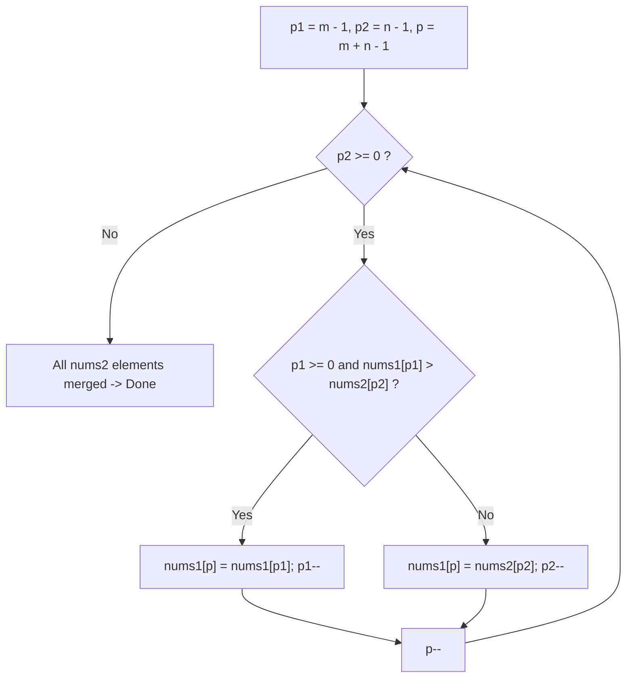

# 0088. Merge Sorted Array

## Problem Description
You are given two integer arrays `nums1` and `nums2`, sorted in **non-decreasing order**, and two integers `m` and `n`, representing the number of elements in `nums1` and `nums2` respectively.

**Merge** `nums1` and `nums2` into a single array sorted in **non-decreasing order**.

The final sorted array should not be returned by the function, but instead be *stored inside the array* `nums1`. To accommodate this, `nums1` has a length of `m + n`, where the first `m` elements denote the elements that should be merged, and the last `n` elements are set to `0` and should be ignored. `nums2` has a length of `n`.

[LeetCode Problem Link](https://leetcode.com/problems/merge-sorted-array/)

---

## 1. Algorithmic Principle: Reverse Three-Pointer Merge

If we merge from left to right (index $0$), writing the smaller element to `nums1[0]` would overwrite an unprocessed element of `nums1` unless we allocate an auxiliary copy of `nums1` ($O(m)$ space).

### In-Place Insight:
The last $n$ slots of `nums1` are unallocated zeroes. By merging **backwards from the largest available index** $m + n - 1$:
- Pointer `p1` starts at $m - 1$ (end of valid numbers in `nums1`).
- Pointer `p2` starts at $n - 1$ (end of `nums2`).
- Pointer `p` starts at $m + n - 1$ (write target).

At any step, the number of empty/consumed slots in `nums1` to the right of `p` is strictly greater than or equal to the number of elements placed from `nums2`. Therefore, `p` will never overwrite an unread element at `p1`.

---

## 2. Visual State Trace

```
nums1: [1, 2, 3, 0, 0, 0], m = 3
nums2: [2, 5, 6], n = 3

p1 = 2 (val 3), p2 = 2 (val 6), p = 5
Compare 3 and 6 -> 6 is larger -> nums1[5] = 6, p2--, p--

p1 = 2 (val 3), p2 = 1 (val 5), p = 4
Compare 3 and 5 -> 5 is larger -> nums1[4] = 5, p2--, p--

p1 = 2 (val 3), p2 = 0 (val 2), p = 3
Compare 3 and 2 -> 3 is larger -> nums1[3] = 3, p1--, p--

p1 = 1 (val 2), p2 = 0 (val 2), p = 2
Compare 2 and 2 -> place nums2[0] = 2 -> nums1[2] = 2, p2--, p--

p2 < 0 -> Finished!
Result: [1, 2, 2, 3, 5, 6]
```



---

## 3. Complexity Analysis

| Metric | Complexity | Notes |
| :--- | :--- | :--- |
| **Time Complexity** | $O(m + n)$ | Each element from `nums1` and `nums2` is inspected and placed at most once. |
| **Space Complexity** | $O(1)$ | Overwrites zeroes at the tail of `nums1` in-place with zero auxiliary allocation. |
