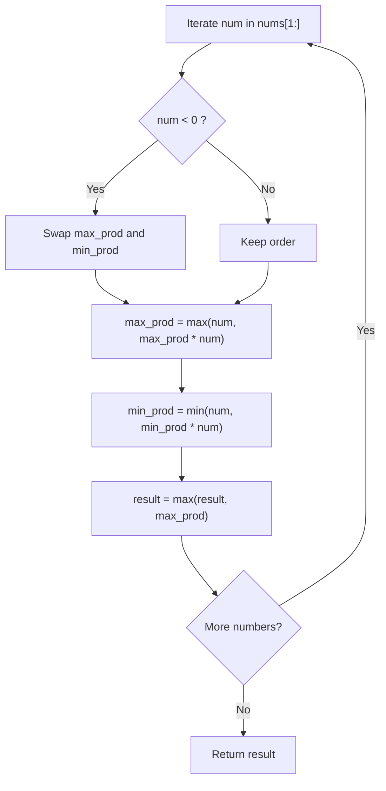

# 0152. Maximum Product Subarray

## Problem Description
Given an integer array `nums`, find a subarray that has the largest product, and return *the product*.

The test cases are generated so that the answer will fit in a **32-bit** integer.

[LeetCode Problem Link](https://leetcode.com/problems/maximum-product-subarray/)

---

## 1. Algorithmic Principle: Dual-Extrema Dynamic Programming

Unlike addition (Kadane's algorithm), where negative numbers strictly decrease sum, multiplication possesses parity inversion:
$$\text{negative} \times \text{negative} = \text{positive}$$

A large negative prefix multiplied by another negative value produces a massive positive candidate.

### Recurrence Relations:
Let $\text{max\_prod}[i]$ and $\text{min\_prod}[i]$ denote the maximum and minimum products of subarrays ending at index $i$:

$$\text{max\_prod}[i] = \max(\text{nums}[i], \text{max\_prod}[i - 1] \cdot \text{nums}[i], \text{min\_prod}[i - 1] \cdot \text{nums}[i])$$
$$\text{min\_prod}[i] = \min(\text{nums}[i], \text{max\_prod}[i - 1] \cdot \text{nums}[i], \text{min\_prod}[i - 1] \cdot \text{nums}[i])$$

If $\text{nums}[i] < 0$, multiplication flips ordering:
$$\max(a \cdot x, b \cdot x) = \min(a, b) \cdot x \quad (\text{for } x < 0)$$
Thus, we swap $\text{max\_prod}$ and $\text{min\_prod}$ before updating.

---

## 2. Decision Diagram

---

## 3. Complexity Analysis

| Metric | Complexity | Notes |
| :--- | :--- | :--- |
| **Time Complexity** | $O(N)$ | Single linear traversal of the array. |
| **Space Complexity** | $O(1)$ | Maintained with 3 scalar variables (`max_prod`, `min_prod`, `result`). |
