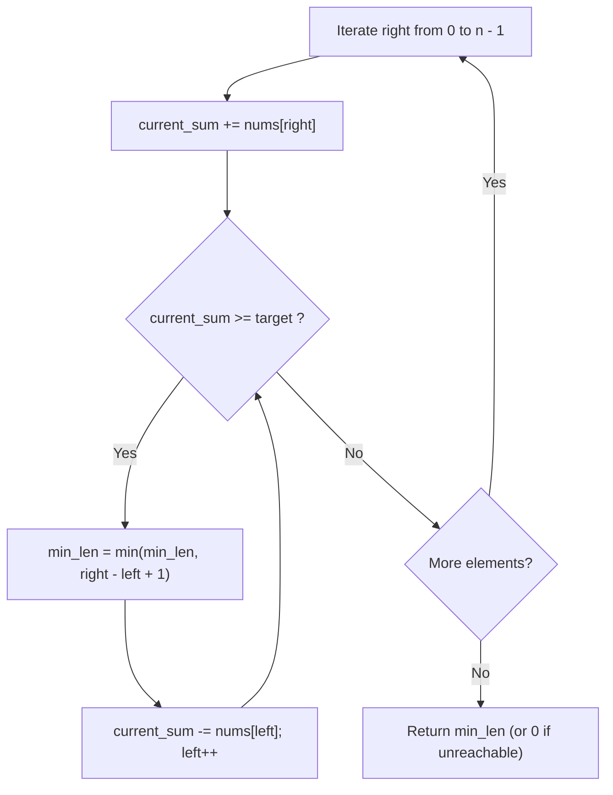

# 0209. Minimum Size Subarray Sum

## Problem Description
Given an array of positive integers `nums` and a positive integer `target`, return the **minimal length** of a subarray whose sum is greater than or equal to `target`. If there is no such subarray, return `0` instead.

**Follow up:** If you have figured out the $O(n)$ solution, try coding another solution of which the time complexity is $O(n \log n)$ (prefix sums + binary search).

[LeetCode Problem Link](https://leetcode.com/problems/minimum-size-subarray-sum/)

---

## 1. Algorithmic Principle: Shrinking Sliding Window

Because all elements in `nums` are positive:
$$\text{Adding elements strictly increases window sum}$$
$$\text{Removing elements strictly decreases window sum}$$

This monotonic property permits a two-pointer sliding window:
1. **Expansion Phase:** Advance `right` and accumulate `current_sum += nums[right]`.
2. **Contraction Phase:** As soon as `current_sum >= target`, record the window length `(right - left + 1)`. Then shrink `left` by subtracting `nums[left]` and incrementing `left` until the sum falls back below `target`.
3. The smallest recorded window length across the entire iteration is the global minimum.

---

## 2. Dynamic Window Movement

```
target = 7, nums = [2, 3, 1, 2, 4, 3]

Window expands:
[2] -> sum = 2
[2, 3] -> sum = 5
[2, 3, 1] -> sum = 6
[2, 3, 1, 2] -> sum = 8 >= 7 (len = 4)
  Contract left: [3, 1, 2] -> sum = 6 < 7 (left advances)
[3, 1, 2, 4] -> sum = 10 >= 7 (len = 4)
  Contract left: [1, 2, 4] -> sum = 7 >= 7 (len = 3)
  Contract left: [2, 4] -> sum = 6 < 7
[2, 4, 3] -> sum = 9 >= 7 (len = 3)
  Contract left: [4, 3] -> sum = 7 >= 7 (len = 2) <-- MINIMUM LENGTH!
  Contract left: [3] -> sum = 3 < 7

Result: 2
```



---

## 3. Complexity Analysis

| Metric | Complexity | Notes |
| :--- | :--- | :--- |
| **Time Complexity** | $O(N)$ | Each index is visited at most twice (once by `right` and once by `left`). |
| **Space Complexity** | $O(1)$ | Modifies no input data and requires $O(1)$ scalar state trackers. |
