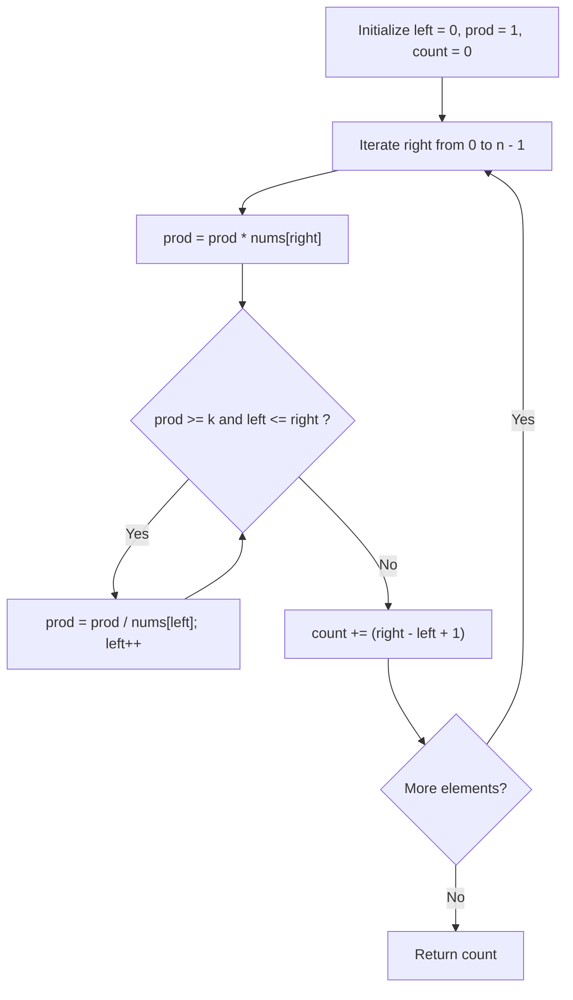

# 0713. Subarray Product Less Than K

## Problem Description
Given an array of integers `nums` and an integer `k`, return *the number of contiguous subarrays where the product of all the elements in the subarray is strictly less than* `k`.

[LeetCode Problem Link](https://leetcode.com/problems/subarray-product-less-than-k/)

---

## 1. Algorithmic Principle: Sliding Window Combinatorics

Because all elements satisfy $\text{nums}[i] \ge 1$:
1. As the window expands (`right` advances), the product $\prod_{i=\text{left}}^{\text{right}} \text{nums}[i]$ is non-decreasing.
2. As the window shrinks (`left` advances), the product is non-increasing.

### The Subarray Contribution Formula:
For any valid window $[\text{left}, \text{right}]$ where the product is strictly less than $k$, how many valid contiguous subarrays terminate exactly at index `right`?
$$\text{Count} = \text{right} - \text{left} + 1$$

These subarrays are:
- $[\text{right}]$
- $[\text{right}-1, \text{right}]$
- $[\text{right}-2, \text{right}]$
- $\dots$
- $[\text{left}, \text{right}]$

Summing this count across all `right` indices counts every valid contiguous subarray exactly once without omission or duplication.

---

## 2. Sliding Window Trace

---

## 3. Complexity Analysis

| Metric | Complexity | Notes |
| :--- | :--- | :--- |
| **Time Complexity** | $O(N)$ | Both `left` and `right` pointers only advance forward, visiting each index at most twice. |
| **Space Complexity** | $O(1)$ | Maintained with constant auxiliary integer variables. |
