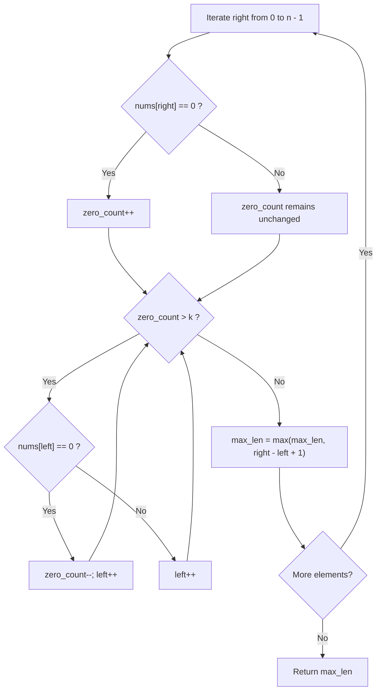

# 1004. Max Consecutive Ones III

## Problem Description
Given a binary array `nums` and an integer `k`, return the *maximum number of consecutive* `1`*s in the array if you can flip at most* `k` `0`*s*.

[LeetCode Problem Link](https://leetcode.com/problems/max-consecutive-ones-iii/)

---

## 1. Problem Equivalence & Algorithmic Principle

Flipping at most $k$ zeroes into ones to maximize consecutive ones is mathematically equivalent to:
$$\text{Find the longest contiguous subarray } [L, R] \text{ containing at most } k \text{ zeroes.}$$

Using a **Resource Budget Sliding Window**:
1. Advance pointer `right`. If $\text{nums}[\text{right}] == 0$, increment `zero_count`.
2. When `zero_count > k`, the budget is violated. Advance pointer `left` until a zero is ejected (`nums[left] == 0`), restoring `zero_count <= k`.
3. At each valid step, the candidate window length is $R - L + 1$. The maximum over all valid windows is our global optimal answer.

---

## 2. Dynamic Window Flow

---

## 3. Complexity Analysis

| Metric | Complexity | Notes |
| :--- | :--- | :--- |
| **Time Complexity** | $O(N)$ | Both `left` and `right` traverse the array monotonically forward. |
| **Space Complexity** | $O(1)$ | No external memory or array allocations required. |
