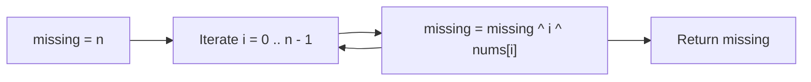

# 0268. Missing Number

## Problem Description
Given an array `nums` containing `n` distinct numbers in the range `[0, n]`, return *the only number in the range that is missing from the array*.

**Follow up:** Could you implement a solution using only $O(1)$ extra space complexity and $O(n)$ runtime complexity?

[LeetCode Problem Link](https://leetcode.com/problems/missing-number/)

---

## 1. Algorithmic Principle: Bitwise XOR Involutive Identity

The bitwise XOR operator ($\oplus$) satisfies three key algebraic properties:
1. **Commutativity:** $a \oplus b = b \oplus a$
2. **Self-Inverse:** $x \oplus x = 0$
3. **Identity Element:** $x \oplus 0 = x$

If we XOR every expected integer from the full set $\{0, 1, \dots, n\}$ and every integer actually observed in `nums`:
$$\text{result} = \left(\bigoplus_{i=0}^{n} i\right) \oplus \left(\bigoplus_{k=0}^{n-1} \text{nums}[k]\right)$$

Every integer present in `nums` appears exactly twice (once in the index loop, once in the array values) and cancels to $0$. The sole missing integer appears only once and is preserved in the accumulator.

---

## 2. Comparison of Approaches

| Approach | Time | Space | Overflow Risk |
| :--- | :--- | :--- | :--- |
| **Bitwise XOR** | $O(N)$ | $O(1)$ | **Zero risk** (bitwise operations do not overflow fixed-width integers). |
| **Gauss Sum** $\frac{n(n+1)}{2} - \sum \text{nums}$ | $O(N)$ | $O(1)$ | Moderate in 32-bit arithmetic for large $N$. |

---

## 3. Complexity Analysis

| Metric | Complexity | Notes |
| :--- | :--- | :--- |
| **Time Complexity** | $O(N)$ | Single linear pass through the array. |
| **Space Complexity** | $O(1)$ | Stored in a single accumulator variable. |
