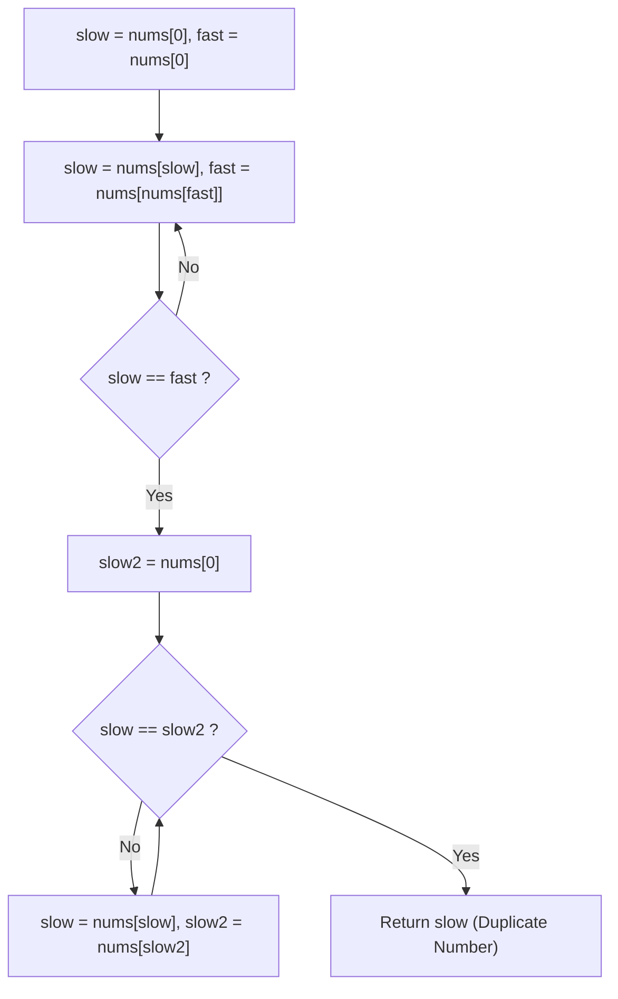

# 0287. Find the Duplicate Number

## Problem Description
Given an array of integers `nums` containing `n + 1` integers where each integer is in the range `[1, n]` inclusive.

There is only **one repeated number** in `nums`, return *this repeated number*.

You must solve the problem **without** modifying the array `nums` and uses only constant extra space.

[LeetCode Problem Link](https://leetcode.com/problems/find-the-duplicate-number/)

---

## 1. Mathematical Principle: Functional Graphs & Cycle Detection

Because `nums` has length $n + 1$ with values in $[1, n]$:
1. Define a directed graph with edges $i \to \text{nums}[i]$.
2. The index $0$ is outside the value range $[1, n]$, so it has no incoming edges ($\text{in-degree}(0) = 0$). It acts as the start of a linked list.
3. Every index $i$ has out-degree $1$ ($\text{nums}[i]$ is unique per index).
4. Since there are $n + 1$ nodes and values are in $[1, n]$, at least one node has in-degree $\ge 2$ (by Pigeonhole Principle).
5. A directed path starting from $0$ must eventually enter a directed cycle. The node where the path enters the cycle is the target duplicate!

---

## 2. Floyd's Tortoise and Hare Derivation

Let:
- $L$ = distance from head ($0$) to cycle entrance.
- $C$ = length of the cycle.
- $d$ = distance from cycle entrance to the meeting point inside the cycle.

```
Head (0) ---- L ----> [Entrance] ---- d ----> [Meeting Point]
                           ^                         |
                           |-------- C - d ----------|
```

When slow and fast meet:
$$\text{Distance(slow)} = L + d$$
$$\text{Distance(fast)} = L + k \cdot C + d = 2 \cdot \text{Distance(slow)}$$
$$L + k \cdot C + d = 2(L + d) \implies L = k \cdot C - d = (k - 1)C + (C - d)$$

This means the distance from Head to the Entrance ($L$) equals the distance from the Meeting Point to the Entrance along the cycle!
Thus, advancing one pointer from Head and one pointer from the Meeting Point at speed 1 guarantees they collide exactly at the **Entrance**!



---

## 3. Complexity Analysis

| Metric | Complexity | Notes |
| :--- | :--- | :--- |
| **Time Complexity** | $O(N)$ | Slow pointer traverses at most $2N$ steps in total. |
| **Space Complexity** | $O(1)$ | Strictly read-only on `nums` with two pointer variables. |
