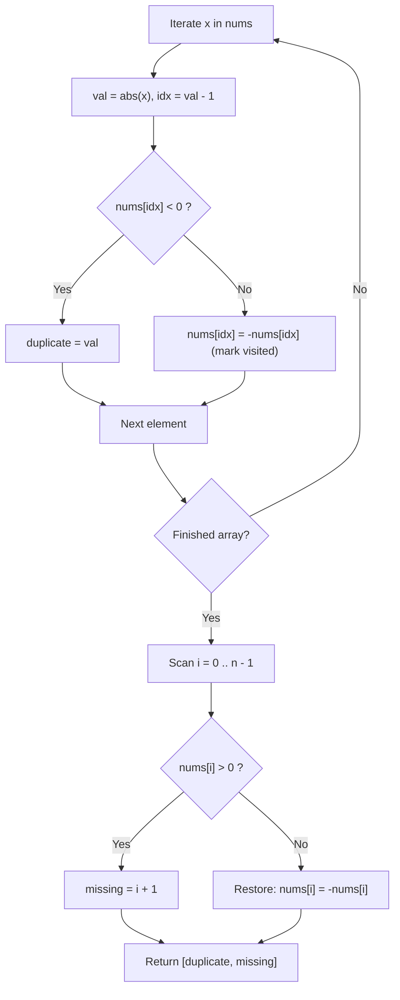

# 0645. Set Mismatch

## Problem Description
You have a set of integers `s`, which originally contains all the numbers from `1` to `n`. Unfortunately, due to some error, one of the numbers in `s` got duplicated to another number in the set, which results in **repetition of one** number and **loss of another** number.

You are given an integer array `nums` representing the data status of this set after the error.

Find the number that occurs twice and the number that is missing and return *them in the form of an array* `[duplicate, missing]`.

[LeetCode Problem Link](https://leetcode.com/problems/set-mismatch/)

---

## 1. Algorithmic Principle: Sign Inversion as Dual Detector

Because the original elements form the set $\{1, 2, \dots, n\}$, each value $x$ has a dedicated canonical array slot at index $x - 1$.

```
State Encoding:
- Unvisited Index: nums[idx] > 0
- Visited Index: nums[idx] < 0

Transition for element x:
1. idx = abs(x) - 1
2. If nums[idx] < 0:
     The slot is ALREADY visited -> x is the DUPLICATE!
3. Else:
     Negate nums[idx] -> mark as visited.

Second Pass:
Scan index i from 0 to n - 1:
- If nums[i] > 0:
     Slot i was NEVER targeted -> (i + 1) is the MISSING number!
```

---

## 2. In-Place State Flow



---

## 3. Complexity Analysis

| Metric | Complexity | Notes |
| :--- | :--- | :--- |
| **Time Complexity** | $O(N)$ | Two linear scans over the array. |
| **Space Complexity** | $O(1)$ | Constant extra space; restores original array state. |
