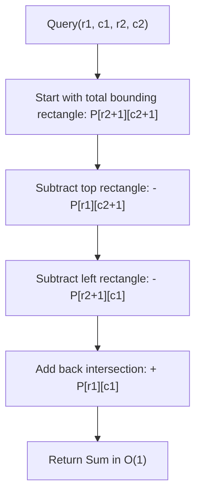

# 0304. Range Sum Query 2D - Immutable

## Problem Description
Given a 2D matrix `matrix`, handle multiple queries of the following type:
- Calculate the sum of the elements of `matrix` inside the rectangle defined by its **upper left corner** `(row1, col1)` and **lower right corner** `(row2, col2)`.

Implement the `NumMatrix` class:
- `NumMatrix(int[][] matrix)` Initializes the object with the integer matrix `matrix`.
- `int sumRegion(int row1, int col1, int row2, int col2)` Returns the sum of the elements of `matrix` inside the rectangle defined by its upper left corner `(row1, col1)` and lower right corner `(row2, col2)`.

You must design an algorithm where `sumRegion` works on **$O(1)$** time complexity.

[LeetCode Problem Link](https://leetcode.com/problems/range-sum-query-2d-immutable/)

---

## 1. Mathematical Principle: 2D Inclusion-Exclusion

Let $P[r + 1][c + 1]$ denote the sum of all elements in the subgrid from $(0, 0)$ to $(r, c)$:

```
(0, 0) ------------- (0, c)
  |                    |
  |      P[r+1][c+1]   |
  |                    |
(r, 0) ------------- (r, c)
```

### Table Construction ($O(M \cdot N)$):
To calculate $P[r + 1][c + 1]$, sum the prefix rectangle above, the prefix rectangle to the left, subtract the doubly-counted top-left intersection, and add the current cell:
$$P[r + 1][c + 1] = \text{matrix}[r][c] + P[r][c + 1] + P[r + 1][c] - P[r][c]$$

### Querying Any Subrectangle ($O(1)$):
To extract the subgrid bounded by $(r_1, c_1)$ and $(r_2, c_2)$:
$$\text{Sum} = P[r_2 + 1][c_2 + 1] - P[r_1][c_2 + 1] - P[r_2 + 1][c_1] + P[r_1][c_1]$$

```
+-------------------+--------------------+
|     P[r1][c1]     |                    |
|    (Overlap +)    |     Top Strip (-)  |
+-------------------+--------------------+
|                   |                    |
|   Left Strip (-)  |   Target Region    |
|                   |                    |
+-------------------+--------------------+
                    (r2, c2)
```

---

## 2. Decision & Geometry Flow



---

## 3. Complexity Analysis

| Metric | Complexity | Notes |
| :--- | :--- | :--- |
| **Constructor Time** | $O(M \cdot N)$ | Single pass over the $M \times N$ matrix to populate the prefix table. |
| **Query Time** | $O(1)$ | Exactly four arithmetic lookups per query. |
| **Space Complexity** | $O(M \cdot N)$ | Uses an $(M + 1) \times (N + 1)$ prefix sum array. |
