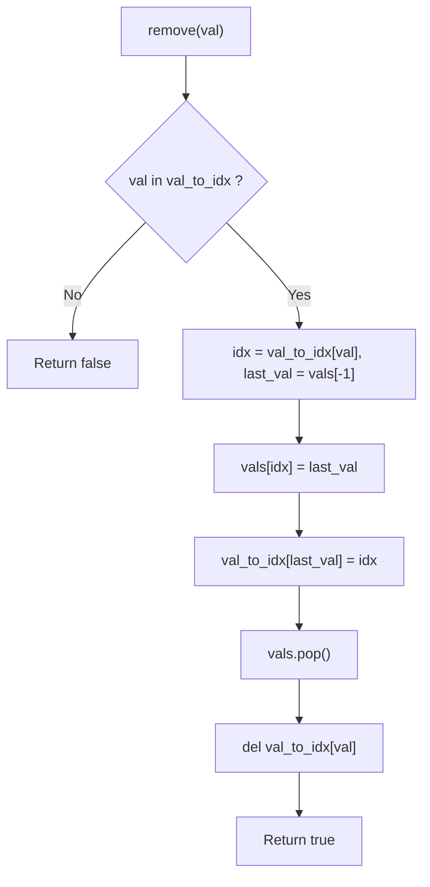

# 0380. Insert Delete GetRandom O(1)

## Problem Description
Implement the `RandomizedSet` class:
- `RandomizedSet()` Initializes the `RandomizedSet` object.
- `bool insert(int val)` Inserts an item `val` into the set if not present. Returns `true` if the item was not present, `false` otherwise.
- `bool remove(int val)` Removes an item `val` from the set if present. Returns `true` if the item was present, `false` otherwise.
- `int getRandom()` Returns a random element from the current set of elements (it's guaranteed that at least one element exists when this method is called). Each element must have the **same probability** of being returned.

You must implement the functions of the class such that each function works in **average $O(1)$** time complexity.

[LeetCode Problem Link](https://leetcode.com/problems/insert-delete-getrandom-o1/)

---

## 1. Architectural Design: Hybrid Data Structure

Why standard collections fail on their own:
- **Hash Table alone:** Provides average $O(1)$ `insert` and `delete`, but does NOT support $O(1)$ uniform random access because keys cannot be indexed continuously from $0$ to $N - 1$.
- **Dynamic Array alone:** Provides $O(1)$ random access (`arr[rand(0, n-1)]`) and $O(1)$ append, but arbitrary element deletion takes $O(N)$ due to shifting.

### The Swap-and-Pop Paradigm:
By combining a **Dynamic Array** and a **Hash Map**:
1. Array stores raw values: `vals = [...]`
2. Hash Map maps each value to its current array index: `val_to_idx = {val: index}`
3. When deleting `val`:
   - Retrieve its index `idx = val_to_idx[val]`.
   - Take the array's last element `last_val = vals[-1]`.
   - Overwrite `vals[idx] = last_val` and update `val_to_idx[last_val] = idx`.
   - Pop `vals[-1]` in $O(1)$ and delete `val` from the hash map.

---

## 2. Complexity Analysis

| Operation | Time Complexity | Space Complexity | Notes |
| :--- | :--- | :--- | :--- |
| **`insert(val)`** | $O(1)$ average | $O(1)$ amortized | Hash map lookup + array append. |
| **`remove(val)`** | $O(1)$ average | $O(1)$ | Hash map update + swap-and-pop. |
| **`getRandom()`** | $O(1)$ | $O(1)$ | Direct indexed lookup on continuous array. |
