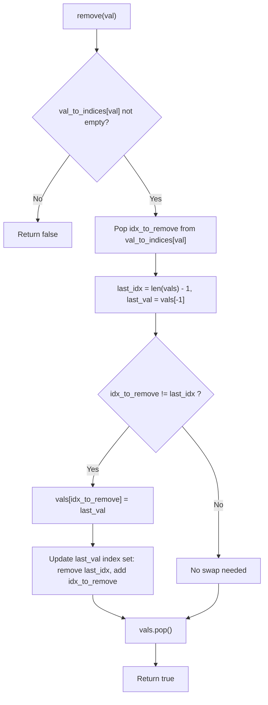

# 0381. Insert Delete GetRandom O(1) - Duplicates allowed

## Problem Description
`RandomizedCollection` is a data structure that contains a collection of numbers, possibly with duplicates (i.e., a multiset). It should support inserting and removing specific elements and also removing a random element.

Implement the `RandomizedCollection` class:
- `RandomizedCollection()` Initializes the empty `RandomizedCollection` object.
- `bool insert(int val)` Inserts an item `val` into the multiset if not present. Returns `true` if the item was not present, `false` otherwise.
- `bool remove(int val)` Removes an item `val` from the multiset if present. Returns `true` if the item was present, `false` otherwise.
- `int getRandom()` Returns a random element from the current multiset of elements. The probability of each element being returned is **linearly related** to the number of same values the multiset contains.

You must implement the functions of the class such that each function works in **average $O(1)$** time complexity.

[LeetCode Problem Link](https://leetcode.com/problems/insert-delete-getrandom-o1-duplicates-allowed/)

---

## 1. Architectural Design: Multiset with Index Tracking

In LeetCode 380, values were unique, so a mapping `val -> int` was sufficient.
Here, because a value can appear multiple times:
1. `vals`: A dynamic array containing all occurrences of all numbers.
   - Preserves frequency: an item appearing $k$ times occupies $k$ slots, giving exact $k / N$ selection probability under uniform index picking.
2. `val_to_indices`: A hash map mapping each value to a **set of indices** where it currently resides in `vals`:
   $$\text{val} \longrightarrow \{\text{idx}_1, \text{idx}_2, \dots\}$$

### Swap-and-Pop with Duplicate Index Sets:
When removing `val`:
1. Pop any index `idx_to_remove` from `val_to_indices[val]`.
2. Let `last_idx = len(vals) - 1` and `last_val = vals[-1]`.
3. If `idx_to_remove != last_idx`:
   - Overwrite `vals[idx_to_remove] = last_val`.
   - Update `val_to_indices[last_val]`: remove `last_idx` and add `idx_to_remove`.
4. Pop `vals[-1]` in $O(1)$.

---

## 2. Complexity Analysis

| Operation | Time Complexity | Space Complexity | Notes |
| :--- | :--- | :--- | :--- |
| **`insert(val)`** | $O(1)$ average | $O(1)$ amortized | Hash table lookup + set insertion + array append. |
| **`remove(val)`** | $O(1)$ average | $O(1)$ | Set pop + swap-and-pop from array. |
| **`getRandom()`** | $O(1)$ | $O(1)$ | Direct indexed random lookup on continuous array. |
