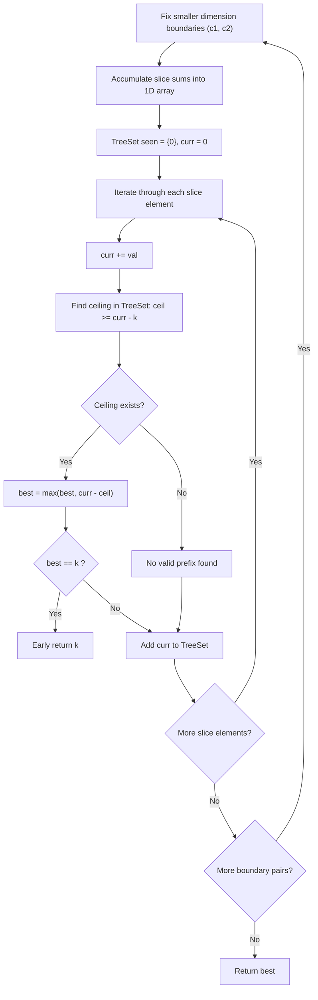

# 0363. Max Sum of Rectangle No Larger Than K

## Problem Description
Given an `m x n` matrix `matrix` and an integer `k`, return the *max sum of a rectangle in the matrix such that its sum is no larger than* `k`.

It is **guaranteed** that there will be a rectangle with a sum no larger than `k`.

[LeetCode Problem Link](https://leetcode.com/problems/max-sum-of-rectangle-no-larger-than-k/)

---

## 1. Algorithmic Principle: 2D Collapse + Binary Search Prefix Lookup

### Dimension Reduction:
Fix the two boundaries of the smaller dimension (e.g. columns $c_1, c_2$). Collapse the 2D grid between $c_1$ and $c_2$ into a 1D array of row slice sums:
$$\text{row\_sum}[r] = \sum_{c=c_1}^{c_2} \text{matrix}[r][c]$$

### 1D Best Subarray Sum $\le k$:
Let $P[j]$ be the running prefix sum:
$$\text{Subarray Sum} = P[j] - P[i] \le k \iff P[i] \ge P[j] - k$$

To **maximize** $(P[j] - P[i])$, we must **minimize** $P[i]$ subject to $P[i] \ge P[j] - k$.
- Store seen prefix sums in a sorted binary search tree (or maintain sorted list).
- Query the ceiling value: the smallest stored prefix $\ge P[j] - k$.
- If a match exists, update our candidate maximum with $P[j] - \text{ceiling}$.
- If the maximum ever hits $k$ exactly, terminate and return $k$ immediately!

---

## 2. Decision Diagram

---

## 3. Complexity Analysis

| Metric | Complexity | Notes |
| :--- | :--- | :--- |
| **Time Complexity** | $O(\min(M, N)^2 \cdot \max(M, N) \log(\max(M, N)))$ | Boundary pairs take $O(\min(M, N)^2)$, and the 1D TreeSet scan takes $O(\max(M, N) \log(\max(M, N)))$. |
| **Space Complexity** | $O(\max(M, N))$ | Stores prefix sums in the binary search tree / array. |
