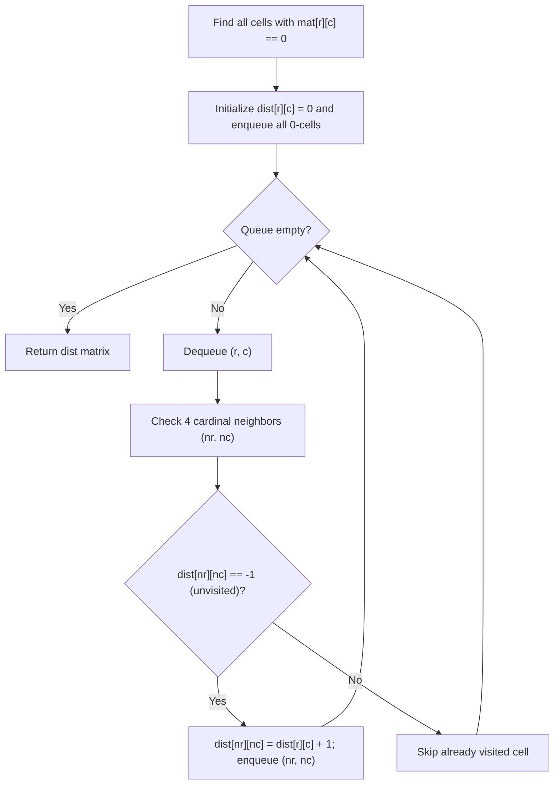

# 0542. 01 Matrix

## Problem Description
Given an `m x n` binary matrix `mat`, return the distance of the nearest `0` for each cell.

The distance between two adjacent cells is `1`.

[LeetCode Problem Link](https://leetcode.com/problems/01-matrix/)

---

## 1. Algorithmic Principle: Multi-Source BFS

Running an individual BFS search from each cell with value `1` yields an unviable time complexity of $O((M \cdot N)^2)$.

### Inversion of Search Perspective:
Instead of searching from each `1` to find a `0`, we initialize a **Multi-Source BFS** simultaneously from all cells containing `0`:
1. Initialize a distance matrix `dist` with `-1` (indicating unvisited) except for all `mat[r][c] == 0`, where `dist[r][c] = 0`.
2. Enqueue all coordinates `(r, c)` where `mat[r][c] == 0`.
3. Traverse outward level-by-level using a FIFO queue.
4. For each cell, explore its 4 cardinal neighbors `(nr, nc)`. If `dist[nr][nc] == -1`:
   $$\text{dist}[nr][nc] = \text{dist}[r][c] + 1$$
   Enqueue `(nr, nc)`.

Because BFS discovers nodes in monotonically increasing order of edge distance, the first time any unvisited cell is reached, the recorded distance is guaranteed to be minimal.

---

## 2. Multi-Source BFS Architecture

---

## 3. Complexity Analysis

| Metric | Complexity | Notes |
| :--- | :--- | :--- |
| **Time Complexity** | $O(M \cdot N)$ | Every cell is enqueued and dequeued at most once. |
| **Space Complexity** | $O(M \cdot N)$ | Queue size and distance matrix proportional to grid dimensions. |
