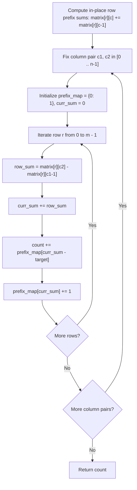

# 1074. Number of Submatrices That Sum to Target

## Problem Description
Given a `matrix` and a `target`, return the number of non-empty submatrices that sum to target.

A submatrix `x1, y1, x2, y2` is the set of all cells `matrix[x][y]` with `x1 <= x <= x2` and `y1 <= y <= y2`.

Two submatrices `(x1, y1, x2, y2)` and `(x1', y1', x2', y2')` are different if they have some coordinate that is different.

[LeetCode Problem Link](https://leetcode.com/problems/number-of-submatrices-that-sum-to-target/)

---

## 1. Algorithmic Principle: 2D-to-1D Dimension Reduction

A naive iteration over all 4 coordinates $(r_1, c_1, r_2, c_2)$ takes $O(M^2 \cdot N^2)$, which is prohibitive for $N, M \le 100$.

### The Submatrix Collapse Trick:
1. Fix two vertical column boundaries: $c_1$ and $c_2$ where $0 \le c_1 \le c_2 < N$.
2. For each row $r$, compute the sum of the horizontal segment between $c_1$ and $c_2$:
   $$\text{slice\_sum}(r) = \sum_{c=c_1}^{c_2} \text{matrix}[r][c]$$
   With precomputed row prefix sums, this query takes $O(1)$ time.
3. Once $c_1$ and $c_2$ are fixed, any 2D submatrix bounded by $(r_1, c_1)$ and $(r_2, c_2)$ has sum:
   $$\text{Total} = \sum_{r=r_1}^{r_2} \text{slice\_sum}(r)$$
4. This transforms the 2D problem into the classic 1D **Subarray Sum Equals K** problem (`LeetCode 560`)!
5. Using a running prefix sum and a frequency hash map:
   $$\text{Count pairs where } (\text{curr\_sum} - \text{target}) \text{ appeared previously.}$$

---

## 2. Dimension Reduction Architecture

---

## 3. Complexity Analysis

| Metric | Complexity | Notes |
| :--- | :--- | :--- |
| **Time Complexity** | $O(N^2 \cdot M)$ | $\frac{N(N+1)}{2}$ column pairs, each scanned across $M$ rows with $O(1)$ hash map operations. |
| **Space Complexity** | $O(M)$ | The hash map contains at most $M + 1$ prefix sum entries per column pair. |
