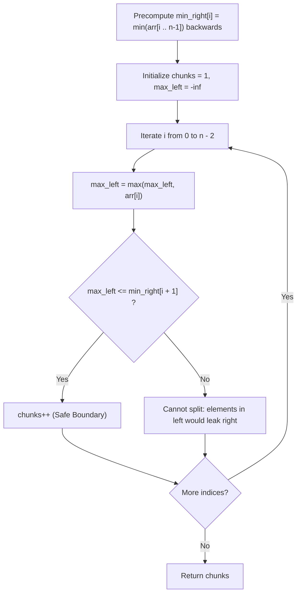

# 0768. Max Chunks To Make Sorted II

## Problem Description
You are given an integer array `arr`.

We split `arr` into some number of **chunks** (i.e., partitions), and individually sort each chunk. After concatenating them, the result should equal the sorted array.

Return *the largest number of chunks we can make to sort the array*.

Unlike Problem 769, `arr` may contain duplicate elements and values outside the range $[0, n - 1]$.

[LeetCode Problem Link](https://leetcode.com/problems/max-chunks-to-make-sorted-ii/)

---

## 1. Algorithmic Principle: Prefix Maximum vs. Suffix Minimum

For any arbitrary array, a partition between index $i$ and index $i + 1$ is valid if and only if **no element in the left partition is strictly greater than any element in the right partition**:
$$\max(\text{arr}[0 \dots i]) \le \min(\text{arr}[i + 1 \dots n - 1])$$

If this condition holds:
- All values in `arr[0..i]` are smaller than or equal to all values in `arr[i+1..n-1]`.
- Sorting the chunks independently guarantees that every element in the left chunk stays to the left of the right chunk.

### Two-Pass Implementation:
1. **Pass 1 (Right-to-Left):** Precompute suffix minimums:
   $$\text{min\_right}[i] = \min(\text{arr}[i \dots n - 1])$$
2. **Pass 2 (Left-to-Right):** Maintain running prefix maximum $\text{max\_left}$. At each index $i \in [0, n - 2]$:
   $$\text{If } \text{max\_left} \le \text{min\_right}[i + 1] \implies \text{increment valid chunk cuts.}$$
3. The total chunks will be $\text{cuts} + 1$.

---

## 2. Decision Flow Diagram

---

## 3. Complexity Analysis

| Metric | Complexity | Notes |
| :--- | :--- | :--- |
| **Time Complexity** | $O(N)$ | Two linear scans (one backward, one forward). |
| **Space Complexity** | $O(N)$ | Auxiliary array `min_right` of size $N$. |
