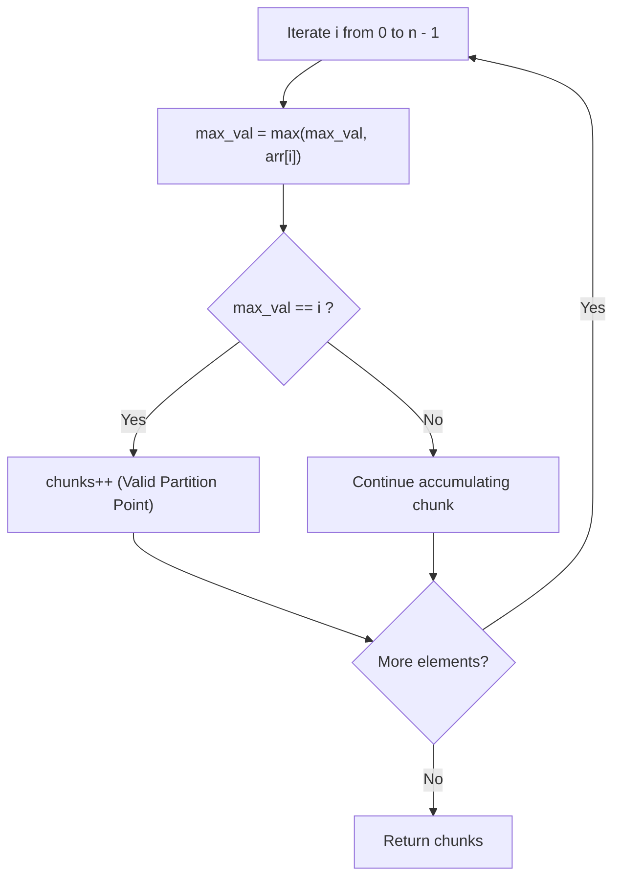

# 0769. Max Chunks To Make Sorted

## Problem Description
You are given an integer array `arr` of length `n` that represents a permutation of the integers in the range `[0, n - 1]`.

We split `arr` into some number of **chunks** (i.e., partitions), and individually sort each chunk. After concatenating them, the result should equal the sorted array.

Return *the largest number of chunks we can make to sort the array*.

[LeetCode Problem Link](https://leetcode.com/problems/max-chunks-to-make-sorted/)

---

## 1. Mathematical Principle: Permutation Index Invariant

Because `arr` is a permutation of the numbers from $0$ to $n - 1$:
- When the entire array is fully sorted, element $k$ must end up at index $k$.
- A partition between index $i$ and index $i + 1$ is valid if and only if all numbers in the prefix `arr[0..i]` belong to the set $\{0, 1, \dots, i\}$.
- Since `arr[0..i]` contains exactly $i + 1$ distinct non-negative integers, they represent the set $\{0, 1, \dots, i\}$ if and only if:
  $$\max(\text{arr}[0 \dots i]) = i$$

Whenever $\max(\text{arr}[0 \dots i]) = i$, no element in `arr[0..i]` needs to travel past index $i$, and no element from `arr[i+1..n-1]` needs to enter `arr[0..i]`. A chunk boundary can be safely placed at $i$.

---

## 2. Visual State Trace

```
arr = [1, 0, 2, 3, 4]

i = 0: val = 1 | max_val = 1 | max_val != 0 (cannot split)
i = 1: val = 0 | max_val = 1 | max_val == 1 -> CHUNK 1 [1, 0]
i = 2: val = 2 | max_val = 2 | max_val == 2 -> CHUNK 2 [2]
i = 3: val = 3 | max_val = 3 | max_val == 3 -> CHUNK 3 [3]
i = 4: val = 4 | max_val = 4 | max_val == 4 -> CHUNK 4 [4]

Total Chunks = 4
```



---

## 3. Complexity Analysis

| Metric | Complexity | Notes |
| :--- | :--- | :--- |
| **Time Complexity** | $O(N)$ | Single forward linear scan. |
| **Space Complexity** | $O(1)$ | Two integer scalar variables (`max_val`, `chunks`). |
