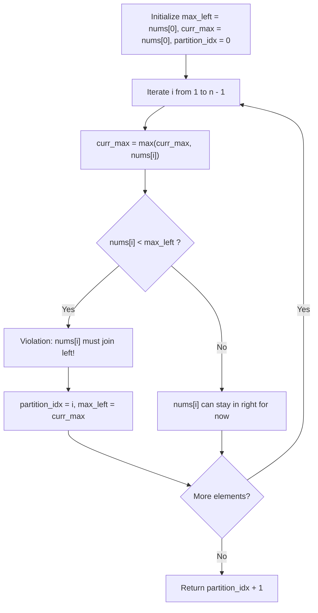

# 0915. Partition Array into Disjoint Intervals

## Problem Description
Given an integer array `nums`, partition it into two contiguous subarrays `left` and `right` such that:
- Every element in `left` is less than or equal to every element in `right`.
- `left` and `right` are non-empty.
- `left` has the **smallest possible size**.

Return *the length of* `left` *after such a partitioning*.

Test cases are generated such that partition exists.

[LeetCode Problem Link](https://leetcode.com/problems/partition-array-into-disjoint-intervals/)

---

## 1. Algorithmic Principle: One-Pass Greedy Horizon Expansion

We require:
$$\max(\text{left}) \le \min(\text{right})$$
with $|\text{left}|$ strictly minimized.

### State Variables:
- `max_left`: Maximum element within our currently confirmed `left` partition. Initially `nums[0]`.
- `curr_max`: Global maximum element observed across all indices up to current pointer $i$. Initially `nums[0]`.
- `partition_idx`: The rightmost index of the confirmed `left` partition. Initially $0$.

### Dynamic Cut Adjustment:
Iterate $i$ from $1$ to $n - 1$:
1. Update global maximum: `curr_max = max(curr_max, nums[i])`.
2. Inspect `nums[i]`:
   - If `nums[i] < max_left`:
     Because `nums[i]` is strictly smaller than an element already in `left`, it **can never legally belong to `right`**!
     Therefore, `left` MUST expand to swallow all elements up through index $i$:
     $$\text{partition\_idx} = i$$
     $$\text{max\_left} = \text{curr\_max}$$
   - If `nums[i] >= max_left`:
     `nums[i]` satisfies the condition to be in `right` for now. We continue scanning without moving `partition_idx`.

At the end of the single pass, `partition_idx + 1` is the minimal valid length of `left`.

---

## 2. Decision Tree & Data Flow

---

## 3. Complexity Analysis

| Metric | Complexity | Notes |
| :--- | :--- | :--- |
| **Time Complexity** | $O(N)$ | Single forward pass through `nums`. |
| **Space Complexity** | $O(1)$ | Operates purely with 3 scalar variables. |
