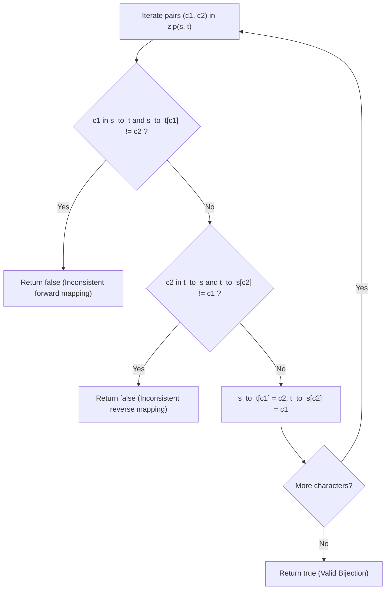

# 0205. Isomorphic Strings

## Problem Description
Given two strings `s` and `t`, determine if they are **isomorphic**.

Two strings `s` and `t` are isomorphic if the characters in `s` can be replaced to get `t`.

All occurrences of a character must be replaced with another character while preserving the order of characters. No two characters may map to the same character, but a character may map to itself.

[LeetCode Problem Link](https://leetcode.com/problems/isomorphic-strings/)

---

## 1. Mathematical Principle: Character Bijection

A valid isomorphism requires a bijective function $f: \Sigma_s \to \Sigma_t$:
1. **Injective (One-to-One):**
   $$f(c_1) = f(c_2) \implies c_1 = c_2$$
   No two distinct characters in $s$ may map to the same character in $t$.
2. **Surjective (Onto):**
   Every character in $t$ is mapped from a unique character in $s$.

To enforce this bidirectional guarantee in $O(1)$ memory:
- Maintain forward map $s \to t$.
- Maintain backward map $t \to s$.
- At each index $i$, if $s[i]$ is mapped to anything other than $t[i]$, or $t[i]$ is mapped to anything other than $s[i]$, the bijection is broken $\implies$ return `false`.

---

## 2. Decision Tree Flow

---

## 3. Complexity Analysis

| Metric | Complexity | Notes |
| :--- | :--- | :--- |
| **Time Complexity** | $O(N)$ | Single pass examining characters at index $i$. |
| **Space Complexity** | $O(1)$ | Fixed character set mapping ($\le 256$ ASCII values). |
