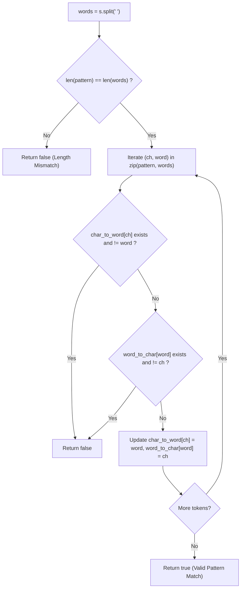

# 0290. Word Pattern

## Problem Description
Given a `pattern` and a string `s`, find if `s` follows the same pattern.

Here **follow** means a full match, such that there is a bijection between a letter in `pattern` and a non-empty word in `s`.

Specifically:
- Each letter in `pattern` maps to exactly one unique word in `s`.
- Each unique word in `s` maps to exactly one letter in `pattern`.
- No two letters map to the same word, and no two words map to the same letter.

[LeetCode Problem Link](https://leetcode.com/problems/word-pattern/)

---

## 1. Algorithmic Principle: Tokenized Bijection

Let $P$ be the array of pattern characters and $W$ be the list of words produced by splitting $s$ on whitespace:
1. **Length Precondition:**
   $$|P| = |W|$$
   If lengths differ, a bijection is impossible $\implies$ return `false`.
2. **Two-Way Consistency:**
   - Map $c \to w$: Verifies that pattern character $c$ always produces word $w$.
   - Map $w \to c$: Verifies that word $w$ is produced exclusively by pattern character $c$.

---

## 2. Decision Tree Flow

---

## 3. Complexity Analysis

| Metric | Complexity | Notes |
| :--- | :--- | :--- |
| **Time Complexity** | $O(N + M)$ | Splitting $s$ takes $O(M)$ where $M = \text{len}(s)$, and scanning $N$ tokens takes $O(N)$ string hash operations. |
| **Space Complexity** | $O(W)$ | Hash maps store up to $W$ distinct words and 26 pattern characters. |
