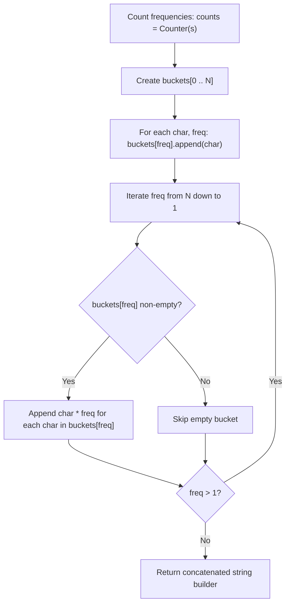

# 0451. Sort Characters By Frequency

## Problem Description
Given a string `s`, sort it in **decreasing order** based on the **frequency** of the characters. The **frequency** of a character is the number of times it appears in the string.

Return *the sorted string*. If there are multiple answers, return *any of them*.

[LeetCode Problem Link](https://leetcode.com/problems/sort-characters-by-frequency/)

---

## 1. Algorithmic Principle: Frequency Bucket Sort

Comparison-based sorting on the alphabet requires $O(K \log K)$ where $K$ is the number of distinct characters ($K \le 62$).

### Linear-Time Bucket Sort ($O(N)$):
1. **Count Frequencies:** Scan $s$ once and map each character $c \to \text{count}(c)$ in $O(N)$.
2. **Bucket Construction:**
   - The maximum possible frequency of any character in a string of length $N$ is $N$.
   - The minimum frequency is $1$.
   - Allocate an array of $N + 1$ buckets, where $\text{bucket}[f]$ stores all characters that appear with frequency $f$.
3. **Reconstruction:**
   - Scan buckets from index $N$ down to $1$.
   - For every character $c \in \text{bucket}[f]$, append $c$ repeated $f$ times to the string builder.

---

## 2. Bucket Architecture

```
String s = "tree" (Length = 4)
Counts: {'t': 1, 'r': 1, 'e': 2}

Buckets (Index = Frequency):
Bucket 4: []
Bucket 3: []
Bucket 2: ['e']
Bucket 1: ['t', 'r']
Bucket 0: []

Scan Backwards:
- From Bucket 2: append 'e' * 2 -> "ee"
- From Bucket 1: append 't' * 1, 'r' * 1 -> "eetr"
```



---

## 3. Complexity Analysis

| Metric | Complexity | Notes |
| :--- | :--- | :--- |
| **Time Complexity** | $O(N)$ | Frequency counting is $O(N)$, bucket population is $O(K) \le O(N)$, and string reconstruction writes exactly $N$ characters. |
| **Space Complexity** | $O(N)$ | Buckets array and string builder bounded by the string length $N$. |
