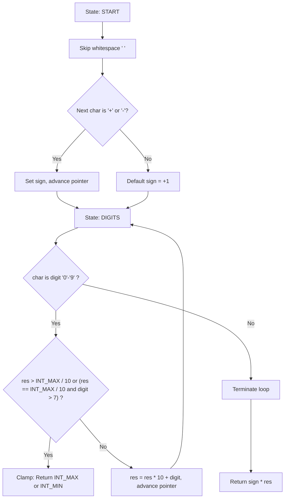

# 0008. String to Integer (atoi)

## Problem Description
Implement the `myAtoi(string s)` function, which converts a string to a 32-bit signed integer.

The algorithm for `myAtoi(string s)` is as follows:
1. **Whitespace:** Ignore any leading whitespace (`" "`).
2. **Signedness:** Determine the sign by checking if the next character is `'-'` or `'+'`, assuming positivity if neither present.
3. **Conversion:** Read the integer by skipping leading zeros until a non-digit character is encountered or the end of the string is reached. If no digits were read, then the result is 0.
4. **Rounding:** If the integer is out of the 32-bit signed integer range $[-2^{31}, 2^{31} - 1]$, then clamp the integer so that it remains in the range. Specifically, integers less than $-2^{31}$ should be clamped to $-2^{31}$, and integers greater than $2^{31} - 1$ should be clamped to $2^{31} - 1$.

Return *the integer as the final result*.

[LeetCode Problem Link](https://leetcode.com/problems/string-to-integer-atoi/)

---

## 1. Algorithmic Principle: Deterministic State Machine

The parser processes characters sequentially through 4 deterministic states:
1. **State 0 (Leading Whitespace):** Advance while character is space `' '`.
2. **State 1 (Sign Parsing):** Read optional sign `'+'` (positive) or `'-'` (negative).
3. **State 2 (Digit Accumulation):** Read ASCII digits `'0'` through `'9'`.
4. **State 3 (Overflow Detection & Clamping):**
   The maximum positive 32-bit integer is $2^{31} - 1 = 2147483647$.
   Before multiplying `res * 10 + digit`:
   $$\text{If } \text{res} > \lfloor \text{INT\_MAX} / 10 \rfloor \text{ OR } (\text{res} == \lfloor \text{INT\_MAX} / 10 \rfloor \text{ AND } \text{digit} > 7):$$
   $$\text{Overflow occurs} \implies \text{Clamp to INT\_MAX (if positive) or INT\_MIN (if negative).}$$

---

## 2. Parsing State Diagram

---

## 3. Complexity Analysis

| Metric | Complexity | Notes |
| :--- | :--- | :--- |
| **Time Complexity** | $O(N)$ | Single forward linear scan over string of length $N$. |
| **Space Complexity** | $O(1)$ | Strictly constant scalar variables. |
