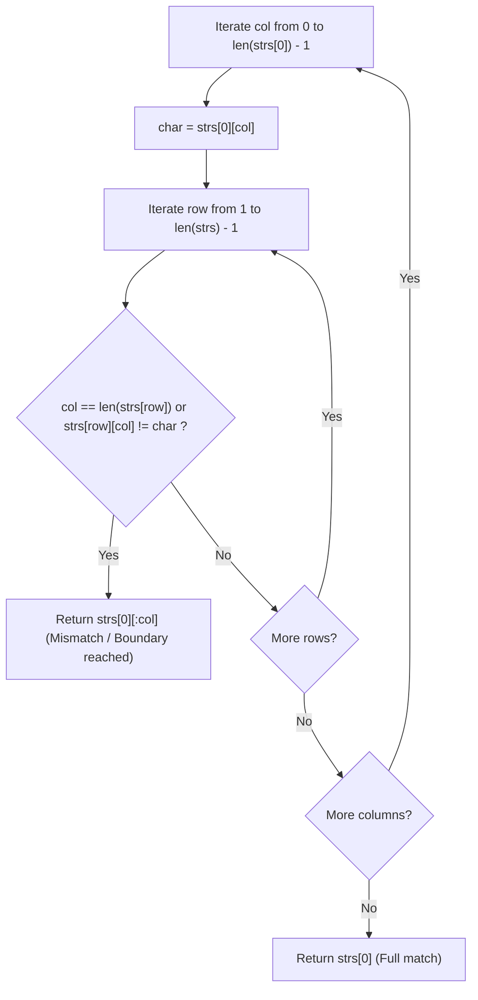

# 0014. Longest Common Prefix

## Problem Description
Write a function to find the longest common prefix string amongst an array of strings.

If there is no common prefix, return an empty string `""`.

[LeetCode Problem Link](https://leetcode.com/problems/longest-common-prefix/)

---

## 1. Algorithmic Principle: Vertical Scanning

Horizontal pairwise prefix scanning (`prefix = common(prefix, s[i])`) can waste comparisons if the very first character mismatches on the last string.

### Vertical Scanning:
1. Fix the column index `col = 0, 1, 2, ...` of the first string `strs[0]`.
2. Inspect `strs[row][col]` for every remaining string `strs[1..n-1]`.
3. If `col == len(strs[row])` (end of a shorter string reached) OR `strs[row][col] != strs[0][col]` (character mismatch):
   - Immediately terminate and return the substring `strs[0][:col]`.
4. If the loop completes without mismatches, the entire `strs[0]` is the common prefix.

---

## 2. Scanning Matrix Flow

```
Row 0: [f] [l] [o] [w] [e] [r]
Row 1: [f] [l] [o] [w]
Row 2: [f] [l] [i] [g] [h] [t]
        |   |   |
Col 0: 'f' == 'f' == 'f' -> Match
Col 1: 'l' == 'l' == 'l' -> Match
Col 2: 'o' == 'o' != 'i' -> MISMATCH! Return "fl"
```



---

## 3. Complexity Analysis

| Metric | Complexity | Notes |
| :--- | :--- | :--- |
| **Time Complexity** | $O(S)$ worst case | $S$ is the total character count across all strings. Average case is much faster ($O(N \cdot L)$ where $L$ is length of the common prefix). |
| **Space Complexity** | $O(1)$ | Strictly constant auxiliary memory. |
