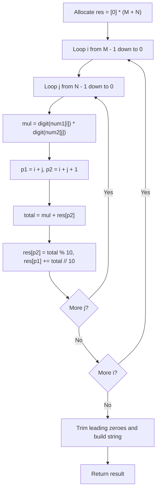

# 0043. Multiply Strings

## Problem Description
Given two non-negative integers `num1` and `num2` represented as strings, return the product of `num1` and `num2`, also represented as a string.

**Note:** You must not use any built-in BigInteger library or convert the inputs to integer directly.

[LeetCode Problem Link](https://leetcode.com/problems/multiply-strings/)

---

## 1. Mathematical Principle: Positional Place-Value Simulation

When multiplying two numbers with $M$ and $N$ digits, the maximum number of digits in their product is bounded:
$$10^{M-1} \cdot 10^{N-1} = 10^{M+N-2} \le \text{Product} < 10^M \cdot 10^N = 10^{M+N}$$
Therefore, the result array `res` requires at most $M + N$ digits.

### Index Mapping Identity:
Consider the multiplication of digit $\text{num}_1[i]$ (from the left, place value $10^{M - 1 - i}$) and digit $\text{num}_2[j]$ (place value $10^{N - 1 - j}$):
$$\text{Product Place Value} = 10^{(M - 1 - i) + (N - 1 - j)} = 10^{(M + N - 1) - (i + j + 1)}$$

This proves that $\text{num}_1[i] \times \text{num}_2[j]$ maps precisely into positions:
- **Units Place:** $p_2 = i + j + 1$
- **Carry Tens Place:** $p_1 = i + j$

Accumulating carries immediately into $p_1$ prevents double-buffering and maintains a clean single-array state.

---

## 2. Visual Multiplication Matrix

```
       1  2  3  (len = 3)
    x     4  5  (len = 2)
    ----------
          1  5  (3 x 5) -> p1=3, p2=4
       1  0     (2 x 5) -> p1=2, p2=3
       5        (1 x 5) -> p1=1, p2=2
    ----------
          6  1  5
    +  4  9  2  0
    ----------
       5  5  3  5
```



---

## 3. Complexity Analysis

| Metric | Complexity | Notes |
| :--- | :--- | :--- |
| **Time Complexity** | $O(M \cdot N)$ | Each pair of digits $(i, j)$ is multiplied and accumulated in $O(1)$ operations. |
| **Space Complexity** | $O(M + N)$ | Result array of size $M + N$. |
