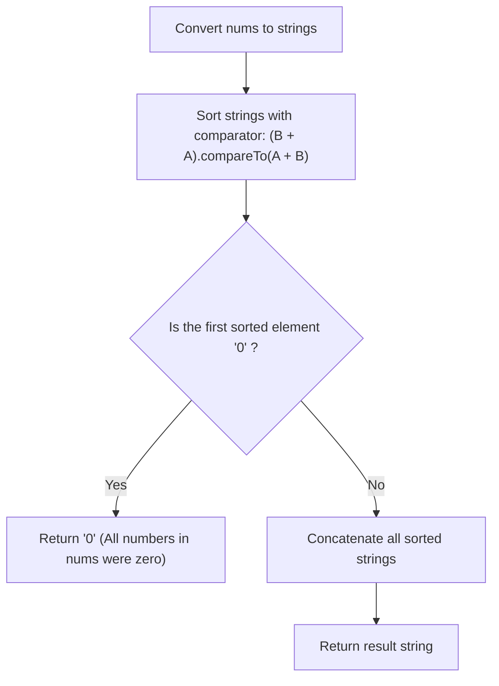

# 0179. Largest Number

## Problem Description
Given a list of non-negative integers `nums`, arrange them such that they form the largest number and return it.

Since the result may be very large, so you need to return a string instead of an integer.

[LeetCode Problem Link](https://leetcode.com/problems/largest-number/)

---

## 1. Algorithmic Principle: Concatenation Transitivity

A simple numerical or lexicographical comparison fails for numbers of unequal digit lengths:
- For `[3, 30]`: Standard numeric order gives $30 > 3$. But `"330" > "303"`, so $3$ must precede $30$!
- For `[3, 34]`: Standard order gives $34 > 3$. And `"343" > "334"`, so $34$ must precede $3$.

### The Concatenation Ordering:
For any two numbers $A$ and $B$, convert them to strings and compare:
$$A \succ B \iff A + B > B + A$$

### Proof of Transitivity (Strict Weak Ordering):
Let $|A|$ denote the number of decimal digits in $A$. Then:
$$A + B = A \cdot 10^{|B|} + B$$
$$B + A = B \cdot 10^{|A|} + A$$
Therefore, $A + B > B + A$ is equivalent to:
$$A(10^{|B|} - 1) > B(10^{|A|} - 1) \iff \frac{A}{10^{|A|} - 1} > \frac{B}{10^{|B|} - 1}$$
Since each string $X$ is mapped to a real number $f(X) = \frac{X}{10^{|X|} - 1}$, the relation $A \succ B \iff f(A) > f(B)$ is strictly transitive! Thus, sorting under this comparator is mathematically guaranteed to find the globally maximum concatenation.

---

## 2. Decision Tree Flow

---

## 3. Complexity Analysis

| Metric | Complexity | Notes |
| :--- | :--- | :--- |
| **Time Complexity** | $O(N \log N \cdot K)$ | Sorting $N$ elements requires $O(N \log N)$ comparisons, each concatenating strings of length $\le K$ ($K \le 10$). |
| **Space Complexity** | $O(N \cdot K)$ | Memory allocated to store the string representations. |
