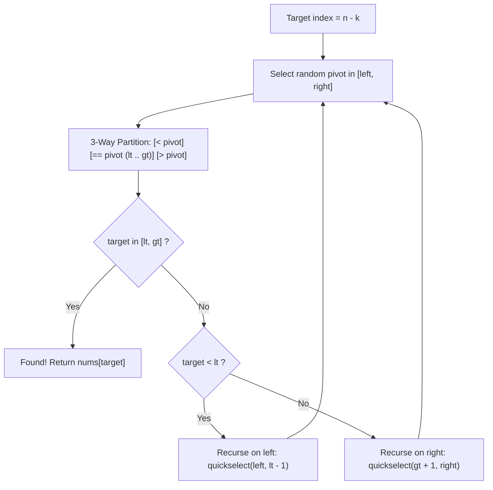

# 0215. Kth Largest Element in an Array

## Problem Description
Given an integer array `nums` and an integer `k`, return the $k^{\text{th}}$ largest element in the array.

Note that it is the $k^{\text{th}}$ largest element in the sorted order, not the $k^{\text{th}}$ distinct element.

Can you solve it without sorting?

[LeetCode Problem Link](https://leetcode.com/problems/kth-largest-element-in-an-array/)

---

## 1. Algorithmic Principle: Randomized Quickselect (Hoare's Selection)

Finding the $k^{\text{th}}$ largest element is equivalent to finding the element at index $\text{target} = n - k$ in $0$-indexed ascending order.

### Quicksort vs. Quickselect:
- **Quicksort:** Partitions array and recursively sorts **both** left and right subproblems:
  $$T(N) = 2 \cdot T(N/2) + O(N) = O(N \log N)$$
- **Quickselect:** Partitions array and recurses on **only the single subproblem** that contains the index `target`:
  $$T(N) = T(N/2) + O(N) = O\left(N \left(1 + \frac{1}{2} + \frac{1}{4} + \dots\right)\right) = O(2N) = O(N)$$

### 3-Way Partitioning (Dutch National Flag Optimization):
Using a 2-way partition on an array with thousands of duplicate numbers causes $O(N^2)$ worst-case time complexity.
A **3-Way Partition** groups elements into three continuous segments:
$$\text{nums}[\text{left} \dots \text{lt} - 1] < \text{pivot}$$
$$\text{nums}[\text{lt} \dots \text{gt}] == \text{pivot}$$
$$\text{nums}[\text{gt} + 1 \dots \text{right}] > \text{pivot}$$

If $\text{target} \in [\text{lt}, \text{gt}]$, the target element is equal to `pivot` and we terminate immediately!

---

## 2. Quickselect Search Space Reduction

---

## 3. Complexity Analysis

| Metric | Complexity | Notes |
| :--- | :--- | :--- |
| **Time Complexity** | $O(N)$ expected | Geometric series reduction $N + \frac{N}{2} + \frac{N}{4} + \dots = O(N)$. Random pivot eliminates adversarial inputs. |
| **Space Complexity** | $O(1)$ auxiliary | Tail-recursive/in-place pointer swapping. Call stack depth is $O(\log N)$ on average. |
