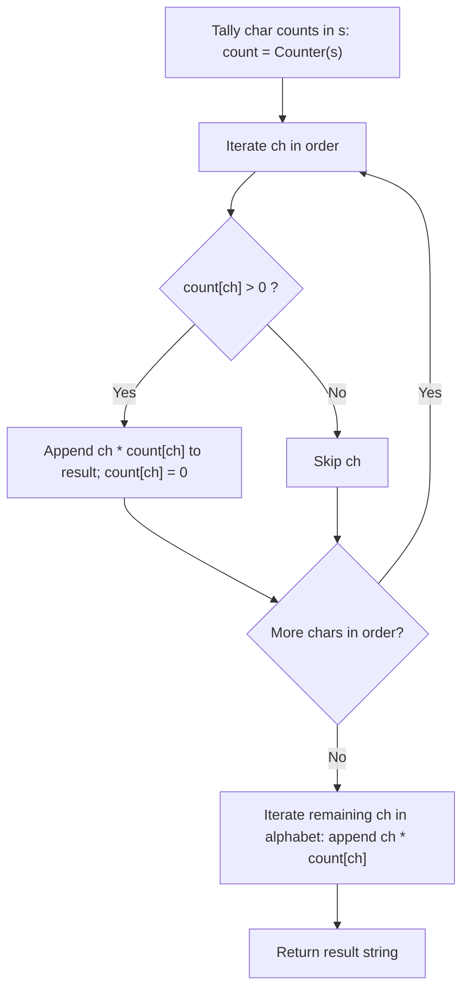

# 0791. Custom Sort String

## Problem Description
You are given two strings `order` and `s`. All the characters of `order` are **unique** and were sorted in some custom order previously.

Permute the characters of `s` so that they match the order that `order` was sorted. More specifically, if a character `x` occurs before a character `y` in `order`, then `x` should occur before `y` in the permuted string.

Return *any permutation of* `s` *that satisfies this property*.

[LeetCode Problem Link](https://leetcode.com/problems/custom-sort-string/)

---

## 1. Algorithmic Principle: Counting Sort with Sequence Constraint

A general comparison sort using a custom index comparator requires $O(N \log N)$ time.
However, because all characters belong to the 26-letter lowercase English alphabet, **Counting Sort** solves the problem in guaranteed $O(|order| + |s|)$ linear time.

### Two-Phase Reconstruction:
1. **Frequency Tabulation:** Tally the frequency of each character in $s$ in an array or hash map of size 26.
2. **Phase 1 (Ordered Flush):** Scan `order` from left to right. For each character $c$, emit $c$ as many times as it occurred in $s$, and reset its frequency count to $0$.
3. **Phase 2 (Tail Flush):** Scan the remaining characters in the frequency table and append them to the output string. Their relative ordering does not violate any rule.

---

## 2. Counting Sort Flow

---

## 3. Complexity Analysis

| Metric | Complexity | Notes |
| :--- | :--- | :--- |
| **Time Complexity** | $O(|order| + |s|)$ | Frequency counting takes $O(|s|)$, scanning `order` takes $O(|order|)$, and flushing remaining characters takes $O(26)$. |
| **Space Complexity** | $O(1)$ | Frequency array bounded by fixed alphabet size ($\le 26$). |
