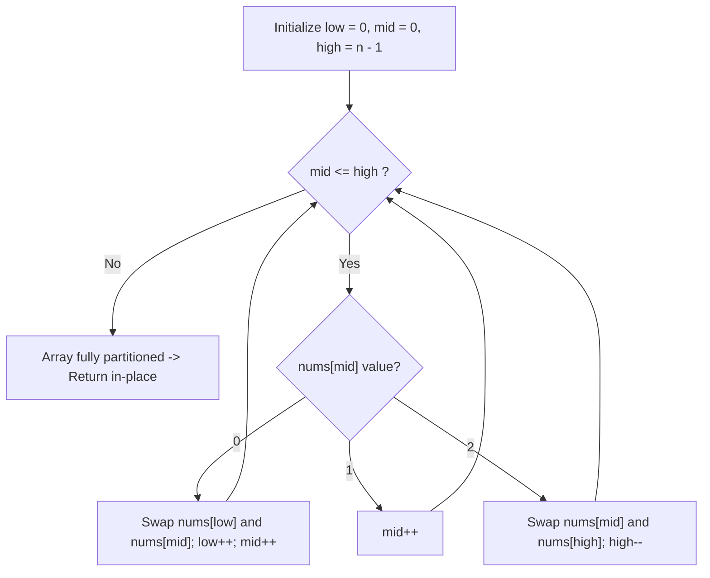

# 0075. Sort Colors

## Problem Description
Given an array `nums` with `n` objects colored red, white, or blue, sort them **in-place** so that objects of the same color are adjacent, with the colors in the order red, white, and blue.

We will use the integers `0`, `1`, and `2` to represent the color red, white, and blue, respectively.

You must solve this problem without using the library's sort function.

**Follow up:** Could you come up with a one-pass algorithm using only constant extra space?

[LeetCode Problem Link](https://leetcode.com/problems/sort-colors/)

---

## 1. Algorithmic Principle: Dijkstra's Dutch National Flag

The Dutch National Flag problem partitions an array into three contiguous zones in a single pass:
```
[ 0, 0, ..., 0 | 1, 1, ..., 1 | ? ? ... ? | 2, 2, ..., 2 ]
  0         low-1  low     mid-1  mid   high  high+1     n-1
```

### Invariants:
- $\text{nums}[0 \dots \text{low} - 1] = 0$
- $\text{nums}[\text{low} \dots \text{mid} - 1] = 1$
- $\text{nums}[\text{mid} \dots \text{high}] = \text{unexamined elements}$
- $\text{nums}[\text{high} + 1 \dots n - 1] = 2$

### State Transitions:
1. **Case $\text{nums}[\text{mid}] == 0$:**
   Swap with $\text{nums}[\text{low}]$. Increment both `low` and `mid`.
2. **Case $\text{nums}[\text{mid}] == 1$:**
   Element is already in the $1$s zone. Increment `mid`.
3. **Case $\text{nums}[\text{mid}] == 2$:**
   Swap with $\text{nums}[\text{high}]$. Decrement `high`. **Do not advance `mid`**, because the element swapped from `high` has not yet been inspected!

---

## 2. Partition Flow Diagram



---

## 3. Complexity Analysis

| Metric | Complexity | Notes |
| :--- | :--- | :--- |
| **Time Complexity** | $O(N)$ | In each step, either `mid` increments or `high` decrements; at most $N$ total operations. |
| **Space Complexity** | $O(1)$ | Strictly in-place with 3 index pointers. |
