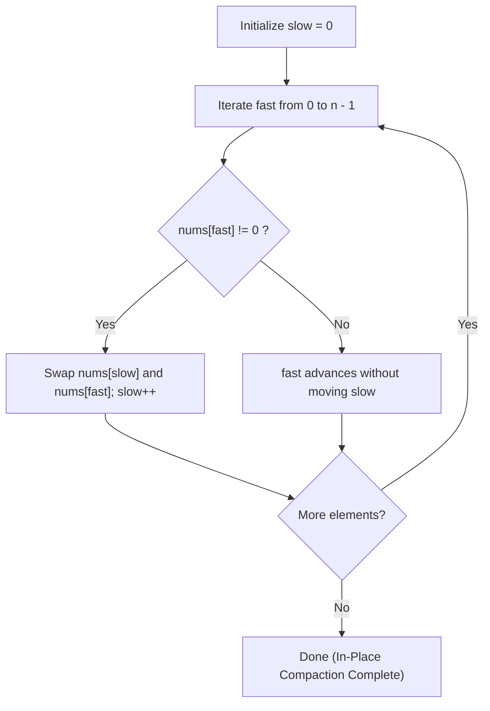

# 0283. Move Zeroes

## Problem Description
Given an integer array `nums`, move all `0`'s to the end of it while maintaining the relative order of the non-zero elements.

**Note** that you must do this in-place without making a copy of the array.

[LeetCode Problem Link](https://leetcode.com/problems/move-zeroes/)

---

## 1. Algorithmic Principle: Fast/Slow In-Place Compaction

We maintain an invariant where the prefix `nums[0 .. slow - 1]` contains all non-zero elements encountered so far in their original relative sequence:
- `slow`: Write head indicating the insertion position for the next non-zero element.
- `fast`: Read head scanning ahead through the array.

### Partition Transition:
When `nums[fast] != 0`:
1. Exchange `nums[slow]` with `nums[fast]`.
2. Advance `slow = slow + 1`.

If all elements up to `fast` are non-zero, `slow == fast` and the swap is a self-assignment ($O(1)$ no-op). Once a zero is encountered, `slow` lags behind, and subsequent swaps move the zero towards the end while shifting non-zeroes forward.

---

## 2. In-Place Compaction Flow

```
nums = [0, 1, 0, 3, 12]

fast = 0: nums[0] == 0 -> slow stays 0
fast = 1: nums[1] == 1 != 0 -> swap nums[0] and nums[1] -> [1, 0, 0, 3, 12], slow = 1
fast = 2: nums[2] == 0 -> slow stays 1
fast = 3: nums[3] == 3 != 0 -> swap nums[1] and nums[3] -> [1, 3, 0, 0, 12], slow = 2
fast = 4: nums[4] == 12 != 0 -> swap nums[2] and nums[4] -> [1, 3, 12, 0, 0], slow = 3

Result: [1, 3, 12, 0, 0]
```



---

## 3. Complexity Analysis

| Metric | Complexity | Notes |
| :--- | :--- | :--- |
| **Time Complexity** | $O(N)$ | Single forward linear scan over the array. |
| **Space Complexity** | $O(1)$ | Constant memory using two pointer variables. |
