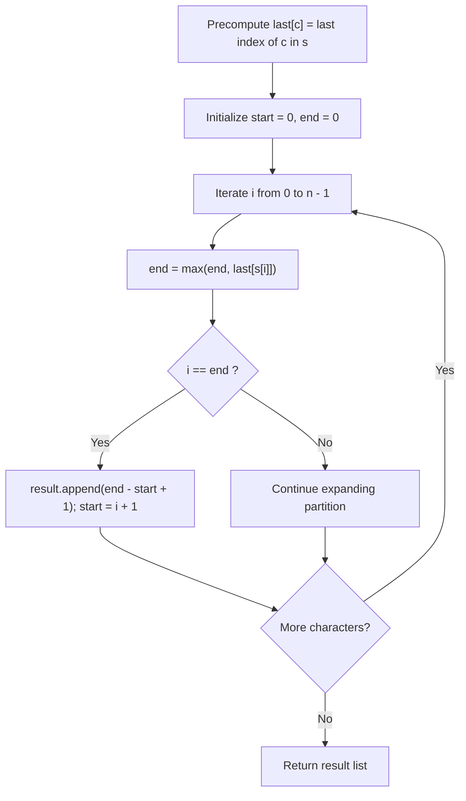

# 0763. Partition Labels

## Problem Description
You are given a string `s`. We want to partition the string into as many parts as possible so that each letter appears in at most one part.

Note that the partition is done so that after concatenating all the parts in order, the resultant string should be `s`.

Return *a list of integers representing the size of these parts*.

[LeetCode Problem Link](https://leetcode.com/problems/partition-labels/)

---

## 1. Algorithmic Principle: Greedy Horizon Expansion

Every letter $c$ inside a partition forces the partition to extend at least until the **last occurrence** of $c$ in the entire string.

### Two-Pass Algorithm:
1. **Pass 1:** Precompute $\text{last}[c] = \text{maximum index of character } c \text{ in } s$.
2. **Pass 2:** Iterate index $i$ from $0$ to $n - 1$:
   - Extend the right boundary:
     $$\text{end} = \max(\text{end}, \text{last}[s[i]])$$
   - If current pointer $i$ reaches the current boundary $\text{end}$:
     No character seen in $s[\text{start} \dots i]$ appears anywhere in the remainder of the string $s[i + 1 \dots n - 1]$.
     Therefore, index $i$ is a safe partition cut!
     Append $(i - \text{start} + 1)$ to our partition sizes and advance $\text{start} = i + 1$.

---

## 2. Dynamic Horizon Flow

```
s = "a b a b c b a c a d e f e g d e h i j h k l i j"
     ^                 ^
     start = 0         last['a'] = 8 -> end = 8
     All 'a', 'b', 'c' are contained within index 0..8 -> Cut 1: Length 9

     Next start = 9:
     'd' (last=14), 'e' (last=15) -> end = 15 -> Cut 2: Length 7

     Next start = 16:
     'h' (last=19), 'i' (last=22), 'j' (last=23) -> end = 23 -> Cut 3: Length 8
```



---

## 3. Complexity Analysis

| Metric | Complexity | Notes |
| :--- | :--- | :--- |
| **Time Complexity** | $O(N)$ | Two sequential scans over string of length $N$. |
| **Space Complexity** | $O(1)$ | Table size bounded by the 26 lowercase English letters. |
