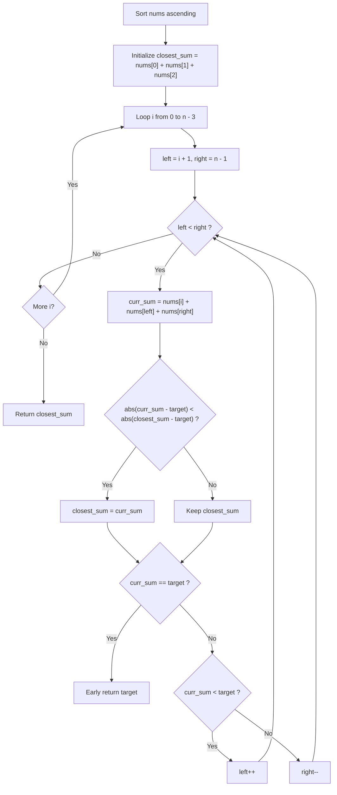

# 0016. 3Sum Closest

## Problem Description
Given an integer array `nums` of length `n` and an integer `target`, find three integers in `nums` such that the sum is closest to `target`.

Return *the sum of the three integers*.

You may assume that each input would have exactly one solution.

[LeetCode Problem Link](https://leetcode.com/problems/3sum-closest/)

---

## 1. Algorithmic Principle: Two-Pointer Convergent Gap Minimization

Brute force checking all triplets takes $O(N^3)$.
By sorting the array $O(N \log N)$, we gain directional monotonicity:

1. Fix the first element index $i$ in $[0 \dots N - 3]$.
2. Initialize two pointers:
   - `left` $= i + 1$
   - `right` $= N - 1$
3. Compute candidate sum: $\text{curr\_sum} = \text{nums}[i] + \text{nums}[\text{left}] + \text{nums}[\text{right}]$.
4. Update `closest_sum` whenever $|\text{curr\_sum} - \text{target}| < |\text{closest\_sum} - \text{target}|$.
5. Decision Branch:
   - If $\text{curr\_sum} < \text{target}$: To increase the sum towards `target`, advance `left = left + 1`.
   - If $\text{curr\_sum} > \text{target}$: To decrease the sum towards `target`, advance `right = right - 1`.
   - If $\text{curr\_sum} == \text{target}$: Exact match found! Terminate immediately with return value `target`.

---

## 2. Decision Tree Flow

---

## 3. Complexity Analysis

| Metric | Complexity | Notes |
| :--- | :--- | :--- |
| **Time Complexity** | $O(N^2)$ | Sorting takes $O(N \log N)$, and the outer loop with two-pointer scan takes $O(N^2)$. |
| **Space Complexity** | $O(1)$ auxiliary | No extra data structures allocated. |
