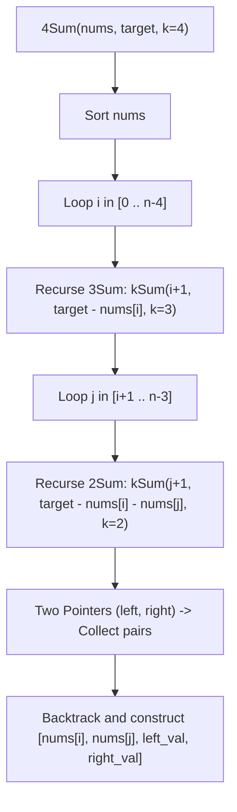

# 0018. 4Sum

## Problem Description
Given an array `nums` of `n` integers, return *an array of all the **unique** quadruplets* `[nums[a], nums[b], nums[c], nums[d]]` such that:
- $0 \le a, b, c, d < n$
- $a, b, c,$ and $d$ are **distinct**.
- $\text{nums}[a] + \text{nums}[b] + \text{nums}[c] + \text{nums}[d] == \text{target}$

You may return the answer in **any order**.

[LeetCode Problem Link](https://leetcode.com/problems/4sum/)

---

## 1. Algorithmic Principle: Generalized K-Sum Reduction

Hardcoding $k$ nested loops creates brittle, non-reusable code. Instead, we implement the **Generalized K-Sum Framework**:

1. **Sort the Array:** $O(N \log N)$ preprocessing enables two-pointer convergence and duplicate deduplication.
2. **Base Case ($k = 2$):** Two-pointer search in $O(N)$ time on sorted subarray `nums[start:]`.
3. **Recursive Reduction ($k > 2$):** Loop index $i$ from `start` to $N - k$:
   - Deduplicate: If $i > \text{start}$ and $\text{nums}[i] == \text{nums}[i - 1]$, skip.
   - Recurse: `kSum(start = i + 1, target = target - nums[i], k = k - 1)`.
4. **Early Pruning Optimization:**
   - Let $\text{avg} = \lfloor \text{target} / k \rfloor$.
   - If $\text{nums}[\text{start}] > \text{avg}$: The smallest $k$ remaining elements sum to more than `target` $\implies$ impossible to reach `target`.
   - If $\text{nums}[N - 1] < \text{avg}$: The largest $k$ remaining elements sum to less than `target` $\implies$ impossible to reach `target`.

---

## 2. K-Sum Recursive Reduction Tree

---

## 3. Complexity Analysis

| Metric | Complexity | Notes |
| :--- | :--- | :--- |
| **Time Complexity** | $O(N^{k - 1}) = O(N^3)$ | $k - 2$ nested loops wrapping the $O(N)$ two-pointer base case. |
| **Space Complexity** | $O(N)$ | Recursion stack depth is at most $k \le 4$. |
