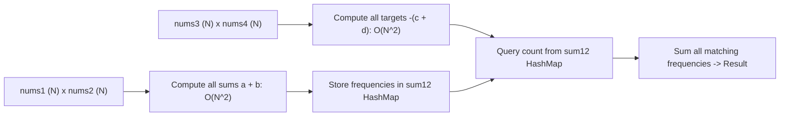

# 0454. 4Sum II

## Problem Description
Given four integer arrays `nums1`, `nums2`, `nums3`, and `nums4` all of length `n`, return the number of tuples `(i, j, k, l)` such that:
- $0 \le i, j, k, l < n$
- $\text{nums1}[i] + \text{nums2}[j] + \text{nums3}[k] + \text{nums4}[l] == 0$

[LeetCode Problem Link](https://leetcode.com/problems/4sum-ii/)

---

## 1. Algorithmic Principle: Meet-in-the-Middle Partitioning

Brute force iteration over all quadruplets $(i, j, k, l)$ takes $O(N^4)$ time, which times out for $N = 500$ ($500^4 \approx 6.25 \times 10^{10}$ operations).

### Meet-in-the-Middle Transformation:
We can algebraically repartition the 4-variable equation into two 2-variable expressions:
$$\text{nums1}[i] + \text{nums2}[j] = -(\text{nums3}[k] + \text{nums4}[l])$$

1. **Step 1 (Preprocessing):** Iterate over all pairs $(a, b) \in \text{nums1} \times \text{nums2}$. Compute the sum $a + b$ and store its occurrence count in a hash map `sum12`. This requires $N^2$ iterations.
2. **Step 2 (Querying):** Iterate over all pairs $(c, d) \in \text{nums3} \times \text{nums4}$. Compute $-(c + d)$ and add $\text{sum12}[-(c + d)]$ to our total tuple counter.

This reduces the computational complexity from $O(N^4)$ down to $O(N^2)$ at the expense of $O(N^2)$ auxiliary hash map storage.

---

## 2. Meet-in-the-Middle Flow

---

## 3. Complexity Analysis

| Metric | Complexity | Notes |
| :--- | :--- | :--- |
| **Time Complexity** | $O(N^2)$ | Two independent $O(N^2)$ double loops. For $N = 500$, $N^2 = 250,000$ operations (executes in $< 50$ ms). |
| **Space Complexity** | $O(N^2)$ | Hash map stores at most $N^2$ unique pairwise sums. |
